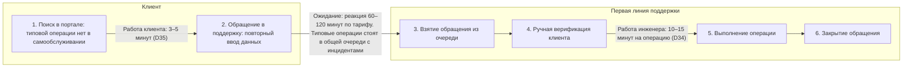
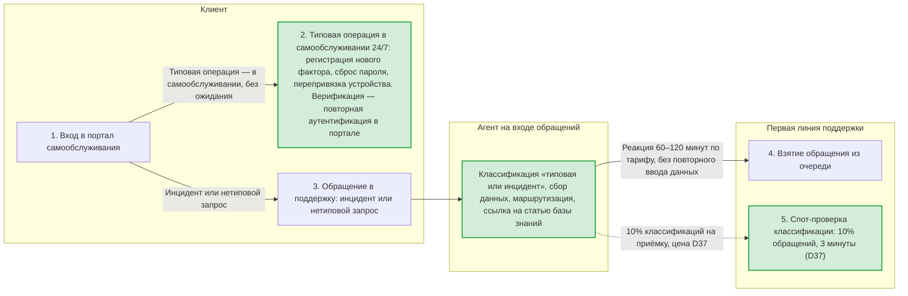
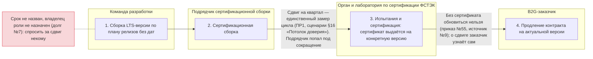

# Санкт-Петербургский Национальный Исследовательский Университет Информационных технологий, механики и оптики

## Практическая работа №3 — Процессы под гипотезы

**Выполнил:** Наумов Михаил Андреевич  
**Группа:** М4200с  
**Санкт-Петербург, 2026**

### Краткая версия паспорта компании

| № | Поле | Описание |
|---|---|---|
| 1 | Бизнес | ООО «МУЛЬТИФАКТОР», российский разработчик ПО для информационной безопасности и IT-инфраструктуры, SaaS/On-Premise |
| 2 | Масштаб | 1,18 млрд ₽ за 2025 год, публичные данные (Rusprofile и Cnews) |
| 3 | Направления | Продажа ПО и сервисов: флагманы Multifactor и Multidirectory, точное распределение не раскрывается |
| 4 | ИТ-функция | Собственная разработка, современный стек, 2FA, активное развитие; зона блока — 🟡 с признаком (не выполнен план по сертифицированной сборке — сдвиг на квартал, долг №1 ПР1), пересмотрена в ПР2 (раздел 7); в ПР1 зона остаётся 🟢 — сам долг №1 адресован ПР1 и открыт там; зоны процессов ПР3 — разделы 2 и 4 |
| 5 | Ограничения | Точное распределение выручки по продуктам не раскрывается, нормировка не требуется (открытая отчётность) |

---

## 1. Какие процессы выбраны

В ПР2 (раздел 6) в работу взяты гипотезы 1, 5 и 3; гипотезы 2 и 4 — в резерве, обе ждут разбивку выручки по продуктам (Т1), гипотеза 2 — дополнительно выгрузку активности лицензий (Т7). Процессы берутся там, где эти гипотезы реализуются: оба процесса — из шага 5 «Поддержка и продление» пути от заказа до денег (ПР1, раздел 1, блок «Ключевые процессы»), в котором замыкается удержание выручки.

| Процесс | Обслуживает | Зона до изменения | Почему берётся |
|---|---|---|---|
| 1. Исполнение типового запроса на обслуживание — часть шага 5 «Поддержка и продление» | Гипотеза 1 (приоритет 0,99, ПР2 раздел 5): активация второго фактора в первые 14 дней | 🟡 Жёлтая — раздел 2 | Потери процесса — то самое «время реакции 60–120 минут по тарифу», на котором построена формулировка гипотезы |
| 2. Выпуск и сертификация LTS-версии — шаг 5 в части продлений B2G | Гипотеза 5 (приоритет 0,389, ПР2 раздел 5): доля B2G-выручки на актуальных версиях | 🔴 Красная — раздел 4 | Гипотеза 5 не запускается, пока процесс не перепроектирован: названный срок и назначенный владелец — условие запуска гипотезы (ПР2, карточка гипотезы 5) |

**Почему нет процесса для гипотезы 3.** Узкое место гипотезы 3 — мощность: миграция D22 0,35–0,9 млн ₽ при потолке D10 100–180 внедрений в год, миграции съедают мощность, ради которой строится гипотеза — риск из карточки гипотезы 3 (ПР2 раздел 3). Это ограничение ресурса, а не потеря времени в шагах: процесс не изменяет число инженеров и потолок внедрений в год. Процессная часть гипотезы 3 — уведомления о сроках релизов — закрывается процессом 2 (изменение №2). Отдельный процесс дублировал бы процесс 2 без новой замеряемой потери: критерий выбора не выполняется.

**Нотация.** Нотация схем равнозначна BPMN: дорожки по ролям; время на переходах — ожидание между дорожками, работа — внутри дорожки. В схемах после изменения зелёным подсвечены изменения, красным помечено то, чего в процессе нет, но что должно быть.

---

## 2. Процесс 1: исполнение типового запроса на обслуживание — как есть

Зона процесса — 🟡 с признаком сползания: типовые операции выполняются вручную в общей очереди с инцидентами, верификация клиента тоже ручная. От красной зоны процесс удерживает то, что обязательства выполняются и имеют источник: SLA 99,99% для облака и сроки техподдержки (multifactor.ru, источник №12), реакция поддержки 60–120 минут по тарифу (ПР2, карточка гипотезы 1).

**Таблица потерь**

| Шаг | Роль | Время работы | Время ожидания | Что теряется | Как бы снял замер |
|---|---|---|---|---|---|
| 1. Поиск операции и создание обращения | Клиент | 3–5 минут (D35) | — | Типовой операции нет в самообслуживании; повторный ввод данных при обращении | Аналитика портала самообслуживания — время от входа до создания обращения, за 12 месяцев; владелец данных — продуктовый владелец портала |
| 2. Ожидание реакции первой линии | — | — | 60–120 минут по тарифу | Основная потеря: типовые операции стоят в общей очереди с инцидентами; у клиента нет срока выполнения операции | Обещание тарифа: реакция 60–120 минут (ПР2, карточка гипотезы 1; multifactor.ru, источник №12). Как бы снял фактическое ожидание: интервалы от создания обращения до первого ответа в трекере, за 12 месяцев |
| 3. Верификация и выполнение | Инженер первой линии | 10–15 минут (D34) | — | Ручной труд на операцию, которую мог бы выполнять портал; ручная верификация клиента | Выгрузка обращений из трекера за 12 месяцев по типу «типовая операция», интервал от взятия до закрытия (D34); владелец данных — руководитель поддержки |
| 4. Закрытие обращения | Инженер первой линии | Учётное действие, время не замеряется | — | — | — |

**Исходная точка.** Ожидание реакции 60–120 минут по тарифу + работа инженера 10–15 минут (D34) + работа клиента 3–5 минут (D35). Поток обращений в поддержку — 44–125 тыс. обращений в год (D30); типовые операции, которые можно увести в портал, — 40–60% потока (D20). Накопленный результат процесса: доля клиентов, активирующих второй фактор в первые 14 дней, не измеряется — метрики нет ни в ПР1, ни в открытых источниках (ПР2, карточка гипотезы 1).

---

## 3. Процесс 1: исполнение типового запроса — после изменения

**Что изменено и почему**

| № | Что изменено (соответствует схеме) | Какую потерю закрывает | Почему это нужно именно гипотезе | Цена |
|---|---|---|---|---|
| 1 | Три типовые операции закрыты в самообслуживании 24/7 — узел 2 схемы | Шаги 1–2: ожидание 60–120 минут по тарифу, работа клиента 3–5 минут (D35) и работа инженера 10–15 минут (D34) на каждую типовую операцию | Гипотеза 1 — самообслуживание закрывает путь активации фактора в первые 14 дней | D33: 0,5–1,5 млн ₽ разово на доработку портала |
| 2 | Верификация клиента встроена в портал: повторная аутентификация вместо ручной проверки инженером | Шаг 3: ручная верификация — точка риска для продукта 2FA | Гипотеза 1 — защищает продукт: ошибка верификации у ИБ-вендора дороже ручного труда | Входит в D33 |
| 3 | Агент на входе обращений: классификация, сбор данных, маршрутизация — новая дорожка схемы | Повторный ввод данных при создании обращения; отсутствие разметки «типовая или инцидент» | Гипотеза 1 — разметка типов нужна пилоту с контрольной группой (правило 6 научной рамки) | D37: 0,1–0,4 млн ₽/год — цена приёмки, расчёт в разделе 8 |
| 4 | SLA в описании тарифа: типовые операции — немедленно в самообслуживании, остальные обращения — реакция 60–120 минут по тарифу | Потерю шага 2 «у клиента нет срока выполнения операции»: обещание не сформулировано | Гипотеза 1 — оформляет обещание, которое проверяет пилот (порог +15 п.п. активации за первые 14 дней) | Изменение описания тарифа, без затрат |

---

## 4. Процесс 2: выпуск и сертификация LTS-версии — как есть

Зона процесса — 🔴 красная: обязательства не заданы — срок не назван, владелец не назначен (долг №7 из ПР2), бизнес узнаёт о проблеме от клиента. Цена красной зоны: риск невыполнения гипотезы 5 — 12–30 млн ₽/год (1,0–2,5% базы 1 181 млн ₽, ПР2 раздел 4); накопленный результат — 46% клиентов вне поддерживаемых конфигураций `N/N−1` и вне LTS, рост с 30% за полгода (ПР1, сценарии §14.2).

**Таблица потерь**

| Шаг | Роль | Время работы | Время ожидания | Что теряется | Как бы снял замер |
|---|---|---|---|---|---|
| 1. Сборка LTS-версии | Команда разработки | Не измеряется | — | План релизов без дат: обязательств наружу нет | Даты тегов релизов в репозитории за 12 месяцев; владелец данных — руководитель разработки |
| 2. Сертификационная сборка | Подрядчик сертификационной сборки | Не измеряется | Сдвиг на квартал | Подрядчик попал под сокращение (ПР1, сценарии §16 «Потолок доверия»); спросить за сдвиг некому | Сдвиг на квартал — единственный замер цикла (ПР1, сценарии §16). Как бы снял: заявки подрядчику — интервалы от заявки до готовой сборки, за 12 месяцев |
| 3. Испытания и сертификация | Орган и лаборатория по сертификации ФСТЭК | Не измеряется | Не измеряется | Каждый релиз — новая сертификация: сертификат ФСТЭК выдаётся на конкретную версию ПО (приказ №55, источник №9) | Реестр сертификатов ФСТЭК — интервалы от подачи заявки до выдачи сертификата |
| 4. Продление контракта | B2G-заказчик | — | — | Без сертификата обновиться нельзя; о сдвиге компания узнаёт от клиента, уведомления нет | Реестр госконтрактов: 4 прямых контракта на 6,6 млн ₽ (источник №22); карточка гипотезы 5 (ПР2 раздел 3) |

**Исходная точка.** Сдвиг сертифицированной LTS-версии на квартал — единственный замер цикла (ПР1, сценарии §16 «Потолок доверия»). Доля контрактов на сертифицированной версии ≈100% по построению (D32): сертификация — обязательный этап. Накопленный результат — 46% клиентов вне поддерживаемых конфигураций `N/N−1` и вне LTS (ПР1, сценарии §14.2, месяц 6): рост с 30% за полгода.

---

## 5. Процесс 2: выпуск и сертификация LTS-версии — после изменения

```mermaid
flowchart LR
    classDef changed fill:#d4edda,stroke:#28a745,stroke-width:2px
    subgraph owner["Владелец сертификационной сборки — назначен CTO в первые 30 дней (ПР1, сценарии §16.5)"]
        V1["Ведёт график сертификации: даты синхронизированы с планом релизов"]:::changed
    end
    subgraph dev["Команда разработки"]
        R1["1. Сборка LTS-версии по плану релизов с датами"]:::changed
    end
    subgraph contractor["Резервный подрядчик со SLA на срок сборки и испытаний"]
        P1["2. Сертификационная сборка по SLA"]:::changed
    end
    subgraph fstek["Орган и лаборатория по сертификации ФСТЭК"]
        F1["3. Испытания и сертификация: сертификат выдаётся на конкретную версию"]
    end
    subgraph agentlane["Агент-ассистент владельца роли"]
        C1["Календарь сертификаций, напоминания о дедлайнах, чеклист испытаний"]:::changed
    end
    subgraph b2g["B2G-заказчик"]
        G1["4. Продление контракта на актуальной версии"]
    end
    V1 --- R1
    R1 --> P1
    P1 --> F1
    F1 -->|"Срок выхода сертифицированной LTS назван заказчику: уведомление вместо ожидания жалобы"| G1
    C1 -.->|"Еженедельная сверка — приёмка ассистента"| V1
```

**Что изменено и почему**

| № | Что изменено (соответствует схеме) | Какую потерю закрывает | Почему это нужно именно гипотезе | Цена |
|---|---|---|---|---|
| 1 | Владелец сертификационной сборки назначен: с полномочиями подписывать заявку в орган по сертификации и вести сроки испытаний — новая дорожка схемы | Красную пометку: «спросить за сдвиг некому» — роль не была закреплена (долг №7) | Гипотеза 5 — это условие запуска гипотезы (ПР2, карточка гипотезы 5): без владельца B2G-выручка не защищена | Решение CTO в первые 30 дней (ПР1, сценарии §16.5), без затрат |
| 2 | График сертификации ведётся владельцем роли: даты синхронизированы с планом релизов | Потерю шага 1: план релизов без дат, обязательств наружу нет | Гипотеза 5; график с датами — предусловие уведомлений о сроках релизов в гипотезе 3 (расширенная поддержка) | Время владельца роли, без отдельной денежной оценки (работа внутри роли) |
| 3 | Срок выхода сертифицированной LTS-версии назван B2G-заказчикам с указанием ответственного — переход в схеме | Потерю шага 4: о сдвиге заказчик узнаёт сам, уведомления нет | Гипотеза 5 — прямая формулировка гипотезы: «назвать B2G-заказчикам новый срок» | Письмо владельца роли, без затрат |
| 4 | Решение по подрядчику: резервный поставщик со SLA на срок сборки и испытаний; альтернатива — инсорсинг | Зависимость от одного подрядчика, попавшего под сокращение (ПР1, сценарии §16 «Потолок доверия») | Гипотеза 5 — риск карточки гипотезы 5: зависимость от подрядчика | SLA — в цену договора; инсорсинг ест мощность при дефиците, разбор в разделе 9 |
| 5 | Агент-ассистент владельца роли: календарь сертификаций, напоминания о дедлайнах, чеклист испытаний — новая дорожка схемы | Ручное ведение графика: владелец роли — единственный держатель сроков | Гипотеза 5; уведомления о сроках релизов — процессная часть гипотезы 3 | Приёмка: еженедельная сверка календаря и напоминаний, без отдельной денежной оценки |

---

## 6. Какие практики ITIL 4 обслуживают процессы

Терминология: «практика» — устойчивый способ работы из ITIL 4; «процесс» — сквозной процесс бизнеса, как в ПР1 и ПР2 (правила курса). Взяты практики, закрывающие потери процессов напрямую.

| Практика ITIL 4 | Обслуживает процесс | Что даёт процессу | Где в работе |
|---|---|---|---|
| Service request management | 1 | Типовой запрос на обслуживание выполняется в самообслуживании, а не первой линией поддержки | Раздел 3, переход «типовая операция — в самообслуживании, без ожидания» |
| Service level management | 1 | Обещание в описании тарифа: типовые операции — немедленно, остальные обращения — реакция 60–120 минут по тарифу | Раздел 3, изменение №4 — меняет описание тарифа, не схему |
| Incident management и problem management | 1 | Инциденты отделяются от типовых запросов классификацией на входе: очередь инцидентов не разбавлена типовыми операциями, повторяющиеся запросы видны как класс | Раздел 3, дорожка агента: классификация «типовая или инцидент» |
| Change enablement | 2 | График сертификации синхронизирован с планом релизов и ведётся владельцем роли | Раздел 5, изменения №1–2 |
| Supplier management | 2 | Подрядчик сертификационной сборки: резервный поставщик со SLA на срок сборки и испытаний | Раздел 5, изменение №4 |

**Почему не Monitoring and event management.** Слабое место процесса 2 — «о сбое узнают от клиента» — закрывается названным сроком и графиком с датами, а не системой мониторинга. Перечисление остальных практик не делается: взяты те, что напрямую закрывают потери процессов.

---

## 7. Метрики DORA

Пункт не пропускается: у компании собственная разработка — ядро собственной разработки, современный стек, публичная дорожная карта (ПР1, раздел 1, блок «ИТ-функция»). Метрики DORA применимы к процессу 2 — циклу выпуска версии.

| Показатель DORA | Значение у компании | Как бы снял замер |
|---|---|---|
| Частота выкаток | Не измеряется (D38) | Теги релизов в репозитории за 12 месяцев; владелец данных — руководитель разработки |
| Время от коммита до прода | Не измеряется (D38) | Конвейер CI/CD: интервалы от коммита до развёртывания |
| Доля неудачных изменений | Не измеряется (D38) | Трекер инцидентов с тегом «после релиза» |
| Время восстановления | Не измеряется (D38) | Трекер инцидентов: интервалы от регистрации до восстановления |

Единственный замер цикла — сдвиг сертифицированной LTS-версии на квартал (ПР1, сценарии §16 «Потолок доверия»): сертифицированный контур структурно хуже обычного пайплайна — каждый релиз требует новой сертификации (приказ №55, источник №9). Пока замеры D38 не сняты, сравнение с отраслевыми значениями не делается: цифра без источника обнуляет критерий (правила курса).

---

## 8. Место агента в процессах

Агент — ассистент на входе потока, а не исполнитель операций. Для каждого процесса — четыре вопроса.

**Процесс 1**

| Вопрос | Ответ |
|---|---|
| 1. Что доверено агенту? | Классификация «типовая или инцидент», сбор данных, маршрутизация, ссылка на статью базы знаний. Не уходит сама операция: клиент выполняет её в самообслуживании, агент не действует от имени клиента |
| 2. Что видит агент? | Текст обращения, каталог статей базы знаний, статус лицензии в CRM. Права: чтение + создание тикета. Не видит персональные данные, не меняет учётные записи |
| 3. Кто и как принимает работу агента? | Спот-проверка первой линией: 10% классификаций, 3 минуты на проверку. Остаточный поток после увода типовых операций — 18–75 тыс. обращений в год (D20, D30); 10% — 1,8–7,5 тыс. проверок × 3 минуты × D36 ≈1 000 ₽/час = 0,1–0,4 млн ₽/год (D37) |
| 4. Что не отдаётся агенту? | Security-операции: продукт 2FA — это сам продукт компании; операции с персональными данными; эскалация к владельцу продукта |

**Процесс 2**

| Вопрос | Ответ |
|---|---|
| 1. Что доверено агенту? | Календарь сертификаций, напоминания о дедлайнах, чеклист испытаний |
| 2. Что видит агент? | График сертификации, план релизов, статус заявок. Права: только чтение |
| 3. Кто и как принимает работу агента? | Владелец роли: еженедельная сверка календаря и напоминаний. Цена — время владельца роли, без отдельной денежной оценки |
| 4. Что не отдаётся агенту? | Решение о переносе даты: у сдвига правовые последствия для B2G-контрактов. Ответственность владельца роли не делегируется |

---

## 9. Эффект на результат и цена изменений

**Что считается эффектом.** Эффект — не «число закрытых тикетов», а накопленный результат на выходе: типовая операция, выполненная в самообслуживании с верификацией. Десять незавершённых попыток дают одну операцию — и затраты за все десять; поэтому пилот гипотезы 1 измеряет активацию фактора, а не число операций.

**Эффект процесса 1**

- Поток обращений 44–125 тыс. в год (D30); в портал уходит 40–60% потока (D20) — уходит 18–75 тыс. обращений в год, остаётся 18–75 тыс. инцидентов и нетиповых запросов.
- Высвобождается 3–19 тыс. часов в год ≈ 1,5–9,4 FTE (2 000 часов в год на FTE); рублёвый эквивалент — 3–19 млн ₽/год (D36 ≈1 000 ₽/час).
- Это не прибыль: ФОТ 72,8 млн ₽/год не сокращается, ИТ-бюджет 421 млн ₽/год зафиксирован (ПР1, сценарии §14.2). Освободившаяся полоса конвертируется через условие собственников №3 — «дополнительное финансирование одного направления ИТ возможно только за счёт сокращения другого» (ПР1, файл сценариев, паспорт проекта, ограничение 3): полоса идёт в мощность внедрений гипотез 3 и 4 с эффектами 24–47 и 18–36 млн ₽/год (ПР2 раздел 4).
- Не суммируется с D26 (26–39 млн ₽/год от прироста ФОТ): та же полоса времени инженеров — правило 5, двойной счёт запрещён.
- Окупаемость доработки портала D33 (0,5–1,5 млн ₽) — один–два месяца полосы по реестру ПР2 (D33: полоса D26 26–39 млн ₽/год); по полосе ПР3 (3–19 млн ₽/год, 0,25–1,58 млн ₽ в месяц) — от двух недель до полугода.

**Эффект процесса 2**

- 12–30 млн ₽/год (1,0–2,5% базы 1 181 млн ₽) возможен только после изменений №1–№3: без владельца и названного срока гипотеза 5 не запускается (ПР2, карточка гипотезы 5).
- Изменения №1–№2 — предусловие для гипотезы 3: уведомления о сроках релизов опираются на график с датами.

**Прогнозы (правило 4 научной рамки)**

- Процесс 1: через два месяца — +15 п.п. активации второго фактора в первые 14 дней (порог гипотезы 1); через три месяца — 40–60% потока в самообслуживании (D20).
- Процесс 2: первый цикл после назначения владельца — сдвиг не более двух недель против квартала.

**Trade-off изменений**

- Процесс 1, скорость против контроля: самообслуживание без ручной верификации быстрее, но ошибка верификации у ИБ-вендора дороже ручного труда — смягчается повторной аутентификацией в портале.
- Процесс 1, качество классификации: ошибка агента (типовая операция принята за инцидент) задерживает реакцию на сбой; спот-проверка 10% не покрывает все ошибки — остаточный риск остаётся.
- Процесс 1, новые постоянные затраты: D37 0,1–0,4 млн ₽/год и разметка типов обращений — новая работа первой линии.
- Процесс 2, резервный подрядчик со SLA дороже разового: альтернатива — инсорсинг, но инсорсинг ест мощность при потолке D10 (миграции D22).
- Процесс 2, жёсткие даты делают сдвиг видимым: уведомление называет проблему раньше жалобы, но не отменяет сдвиг — доверие B2G страдает в обоих случаях.
- Процесс 2, владелец роли и агент-ассистент — новые роли: процесс дороже в человеко-часах. Это цена красной зоны: бесплатных процессов в ней не бывает.

---

## 10. Реестр допущений

Допущения D1–D33 наследуются из ПР2 (раздел 8) без изменений. Новые допущения ПР3:

| ID | Допущение | Значение | Источник и обоснование | Уверенность | Кто или что проверит |
|---|---|---|---|---|---|
| D34 | Время работы инженера на типовую операцию, включая верификацию | 10–15 минут | Нет замера. Как бы снял: выгрузка обращений из трекера за 12 месяцев по типу «типовая операция», интервал от взятия до закрытия (раздел 2) | низкая | Выгрузка обращений за 12 месяцев с разбивкой по типам — пилот гипотезы 1, вместе с D20 и D30 |
| D35 | Время клиента на поиск операции и создание обращения | 3–5 минут | Нет замера. Как бы снял: аналитика портала самообслуживания — время от входа до создания обращения, за 12 месяцев | низкая | Аналитика портала после запуска доработки (D33) |
| D36 | Ставка часа инженера поддержки | ≈1 000 ₽/час | Расчёт от D3 (зарплата 2,064 млн ₽/год, реестр ПР1): 2 064 000 ÷ 2 000 рабочих часов в год ≈ 1 032 ₽/час, в расчётах берётся 1 000 ₽/час | средняя | Пересчёт по фактическим данным: ФОТ поддержки 72,8 млн ₽/год (D8 × D3, расчёт ПР2 раздел 4) ÷ 35,3 FTE ÷ 2 000 часов |
| D37 | Цена приёмки классификации агента | 0,1–0,4 млн ₽/год | Остаточный поток после увода типовых операций: 18–75 тыс. обращений в год (D20 × D30) × 10% спот-проверок × 3 минуты × D36 ≈1 000 ₽/час | низкая | Учёт времени спот-проверок в трекере после запуска агента |
| D38 | Показатели DORA | Не измеряются | Ни один из четырёх показателей не замеряется; единственный замер цикла — сдвиг сертифицированной LTS-версии на квартал (ПР1, сценарии §16 «Потолок доверия») | низкая | Первый цикл процесса 2 после изменений: теги релизов, конвейер CI/CD, трекер инцидентов, реестр сертификатов ФСТЭК (источник №9) |

---

## 11. Источники

Источники №1–23 наследуются из ПР2 (раздел 9) без изменений. Новые источники ПР3:

24. ITIL 4 (система создания ценности услуг, практики управления услугами) // AXELOS URL: https://www.axelos.com/certifications/itil-service-management (дата обращения: 20.10.2026)
25. Forsgren N., Humble J., Kim G. Accelerate: The Science of Lean Software and DevOps // IT Revolution Press, 2018; базовые значения показателей DORA // DORA URL: https://dora.dev (дата обращения: 20.10.2026)

Ссылки на ПР1 и ПР2 в тексте даны по разделам и карточкам гипотез. Ветка `pw_3` не наследует файлы ПР1 и ПР2 по требованию к структуре работы: отсылки вида «ПР1, раздел…», «ПР1, сценарии §…» и «ПР2, раздел…» читаются в ветках `pw_1` и `pw_2`.

