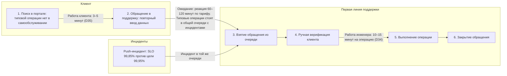
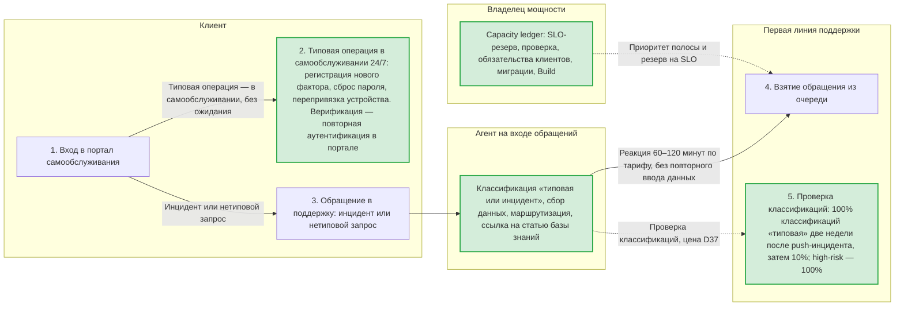
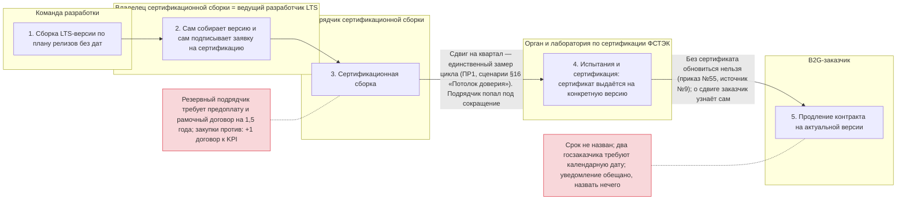
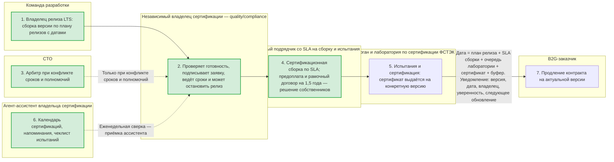
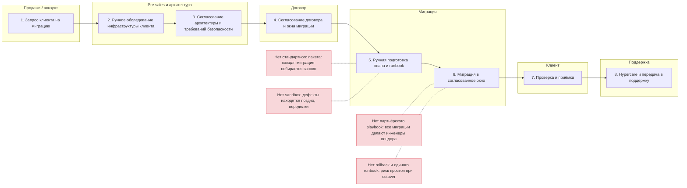

# Санкт-Петербургский Национальный Исследовательский Университет Информационных технологий, механики и оптики

## Практическая работа №3 — Процессы под гипотезы

**Выполнил:** Наумов Михаил Андреевич  
**Группа:** М4200с  
**Санкт-Петербург, 2026**

### Краткая версия паспорта компании

| № | Поле | Описание |
|---|---|---|
| 1 | Бизнес | ООО «МУЛЬТИФАКТОР», российский разработчик ПО для информационной безопасности и IT-инфраструктуры, SaaS/On-Premise |
| 2 | Масштаб | 1,18 млрд ₽ за 2025 год, публичные данные (Rusprofile и Cnews) |
| 3 | Направления | Продажа ПО и сервисов: флагманы Multifactor и Multidirectory, точное распределение не раскрывается |
| 4 | ИТ-функция | Собственная разработка, современный стек, 2FA, активное развитие; зона блока — 🟡 с признаком (не выполнен план по сертифицированной сборке — сдвиг на квартал, долг №1 ПР1), пересмотрена в ПР2 (раздел 7); в ПР1 зона остаётся 🟢 — сам долг №1 адресован ПР1 и открыт там; зоны процессов ПР3 — разделы 2, 4, 6; зоны гипотез — раздел 12.7, зелёной нет ни у одной |
| 5 | Ограничения | Точное распределение выручки по продуктам не раскрывается, нормировка не требуется (открытая отчётность) |

---

## 1. Какие процессы выбраны

В ПР2 (раздел 6) в работу взяты гипотезы 1, 5 и 3; гипотезы 2 и 4 — в резерве, обе ждут разбивку выручки по продуктам (Т1), гипотеза 2 — дополнительно выгрузку активности лицензий (Т7). Процессы берутся там, где эти гипотезы реализуются: процессы 1 и 2 — из шага 5 «Поддержка и продление» пути от заказа до денег (ПР1, раздел 1, блок «Ключевые процессы»), процесс 3 — из шага 4 «Развертывание и интеграция» с переходом в шаг 5.

| Процесс | Обслуживает | Зона до изменения | Почему берётся |
|---|---|---|---|
| 1. Исполнение типового запроса на обслуживание — часть шага 5 «Поддержка и продление» | Гипотеза 1 (приоритет 0,99, ПР2 раздел 5): активация второго фактора в первые 14 дней | 🟡 по SLA поддержки, 🔴 по SLO аутентификации — раздел 2 | Потери процесса — то самое «время реакции 60–120 минут по тарифу», на котором построена формулировка гипотезы; после push-инцидента SLO 99,85% ниже цели 99,95% |
| 2. Выпуск и сертификация LTS-версии — шаг 5 в части продлений B2G | Гипотеза 5 (приоритет 0,389, ПР2 раздел 5): доля B2G-выручки на актуальных версиях | 🔴 Красная — раздел 4 | Гипотеза 5 не запускается, пока процесс не перепроектирован: названный срок и независимый владелец — условие запуска гипотезы (ПР2, карточка гипотезы 5) |
| 3. Перевод B2B-клиента с on-premise на управляемый сервис — шаги 4–5 пути от заказа до денег | Гипотеза 3 (приоритет 0,389, ПР2 раздел 5): доля клиентов на управляемом сервисе и тариф расширенной поддержки | 🟡 Жёлтая с красным риском — раздел 6 | Гипотеза 3 принята в ПР2, но её мощность — не абстрактный ресурс, а процесс с очередью, ожиданиями и передачами; без него нельзя отделить стандартную миграцию от нестандартной и посчитать, сколько часов забирают два крупных клиента |

**Почему процесс 3 добавлен в пересмотренной редакции.** В первой редакции процесса 3 не было: узкое место гипотезы 3 считалось только ограничением ресурса. Push-инцидент и два нестандартных клиента показали обратное: миграции — это процесс, в котором стандартный и нестандартный путь смешаны, клиентские ожидания не измеряются, а инженеры одновременно нужны на контроль качества, внедрения и удержание SLO. Процесс 3 делает эту конкуренцию за мощность видимой и позволяет перепроектировать её, а не просто констатировать дефицит.

**Нотация.** Нотация схем равнозначна BPMN: дорожки по ролям; время на переходах — ожидание между дорожками, работа — внутри дорожки. В схемах после изменения зелёным подсвечены изменения, красным помечено то, чего в процессе нет, но что должно быть.

---

## 2. Процесс 1: исполнение типового запроса на обслуживание — как есть

Зона процесса — 🟡 по обязательствам поддержки и 🔴 по SLO аутентификации. Типовые операции выполняются вручную в общей очереди с инцидентами, верификация клиента тоже ручная. SLA поддержки — реакция 60–120 минут по тарифу — выполняется и имеет источник (ПР2, карточка гипотезы 1; multifactor.ru, источник №12). Но связанный сценарий аутентификации уже в красной зоне: SLO 99,85% против цели 99,95% (ПР1, сценарии §14.3) — это примерно 64,8 минуты недоступности в месяц против 21,6 по цели, то есть error budget превышен втрое. Нельзя говорить, что обязательства выполняются целиком: SLA процесса и SLO сценария — разные обязательства. Push-инцидент поставил типовые запросы в одну очередь с инцидентами; гипотеза 1 не зелёная. Связь push-инцидента с ошибкой классификации не доказана: инцидент — про доступность, а требование 100% проверки — превентивное, а не вывод из замера. Поэтому политика двух недель, а не постоянная.

**Таблица потерь**

| Шаг | Роль | Время работы | Время ожидания | Что теряется | Как бы снял замер |
|---|---|---|---|---|---|
| 1. Поиск операции и создание обращения | Клиент | 3–5 минут (D35) | — | Типовой операции нет в самообслуживании; повторный ввод данных при обращении | Аналитика портала самообслуживания — время от входа до создания обращения, за 12 месяцев; владелец данных — продуктовый владелец портала |
| 2. Ожидание реакции первой линии | — | — | 60–120 минут по тарифу | Основная потеря: типовые операции стоят в общей очереди с инцидентами; у клиента нет срока выполнения операции | Обещание тарифа: реакция 60–120 минут (ПР2, карточка гипотезы 1; multifactor.ru, источник №12). Как бы снял фактическое ожидание: интервалы от создания обращения до первого ответа в трекере, за 12 месяцев |
| 2a. Ожидание инцидента push в общей очереди | Инженер первой линии / инцидент-менеджер | Не измеряется | Входит в 60–120 минут | Инцидент и типовые запросы конкурируют за одну очередь; SLO 99,85% против цели 99,95%, error budget превышен втрое | SLO-отчёт и трекер: доля инцидентов, ожидавших в очереди типовых запросов; интервалы от регистрации до восстановления |
| 3. Верификация и выполнение | Инженер первой линии | 10–15 минут (D34) | — | Ручной труд на операцию, которую мог бы выполнять портал; ручная верификация клиента | Выгрузка обращений из трекера за 12 месяцев по типу «типовая операция», интервал от взятия до закрытия (D34); владелец данных — руководитель поддержки |
| 4. Закрытие обращения | Инженер первой линии | Учётное действие, время не замеряется | — | — | Не требуется: действие не влияет на потерю |

**Исходная точка.** Ожидание реакции 60–120 минут по тарифу + работа инженера 10–15 минут (D34) + работа клиента 3–5 минут (D35). Поток обращений в поддержку — 44–125 тыс. обращений в год (D30); типовые операции, которые можно увести в портал, — 40–60% потока (D20). Накопленный результат процесса: доля клиентов, активирующих второй фактор в первые 14 дней, не измеряется — метрики нет ни в ПР1, ни в открытых источниках (ПР2, карточка гипотезы 1). Фактический SLO основной аутентификации — 99,85% против цели 99,95% (ПР1, сценарии §14.3).

---

## 3. Процесс 1: исполнение типового запроса — после изменения

**Что изменено и почему**

| № | Что изменено (соответствует схеме) | Какую потерю закрывает | Почему это нужно именно гипотезе | Цена |
|---|---|---|---|---|
| 1 | Три типовые операции закрыты в самообслуживании 24/7 — узел 2 схемы | Шаги 1–2: ожидание 60–120 минут по тарифу, работа клиента 3–5 минут (D35) и работа инженера 10–15 минут (D34) на каждую типовую операцию | Гипотеза 1 — самообслуживание закрывает путь активации фактора в первые 14 дней | D33: 0,5–1,5 млн ₽ разово на доработку портала |
| 2 | Верификация клиента встроена в портал: повторная аутентификация вместо ручной проверки инженером | Шаг 3: ручная верификация — точка риска для продукта 2FA | Гипотеза 1 — защищает продукт: ошибка верификации у ИБ-вендора дороже ручного труда | Входит в D33 |
| 3 | Агент на входе обращений: классификация, сбор данных, маршрутизация — новая дорожка схемы | Повторный ввод данных при создании обращения; отсутствие разметки «типовая или инцидент» | Гипотеза 1 — разметка типов нужна пилоту на реальных пользователях с контрольной группой | D37: 0,13–0,25 млн ₽/год при проверке 10%; риск-ориентированная — 0,18–0,34 млн ₽/год, расчёт в разделе 3 и D37 |
| 4 | SLA в описании тарифа: типовые операции — немедленно в самообслуживании, остальные обращения — реакция 60–120 минут по тарифу | Потерю шага 2 «у клиента нет срока выполнения операции»: обещание не сформулировано | Гипотеза 1 — оформляет обещание, которое проверяет пилот (порог +15 п.п. активации за первые 14 дней) | Изменение описания тарифа, без затрат |
| 5 | Проверка классификаций риск-ориентированная: 100% классификаций «типовая» две недели после push-инцидента, затем 10%; high-risk — 100% постоянно — узел 5 схемы | Риск ошибки агента, который задерживает реакцию на инцидент и расходует error budget; требование главы поддержки проверять всё после push-инцидента | Гипотеза 1 — качество классификации защищает SLO, без которого активация не имеет ценности | 0,18–0,34 млн ₽/год вместо 1,32–2,50 млн ₽/год при постоянных 100%; разбор в разделе 12 |
| 6 | Capacity ledger и приоритет мощности — новая дорожка схемы | Одну и ту же полосу одновременно забирают проверка, два нестандартных клиента, миграции и SLO-резерв | Гипотезы 1 и 3 — освобождённая порталом мощность не появляется автоматически и не может быть обещана дважды | Управленческое время; предотвращает перебронирование полосы |
| 7 | Два нестандартных клиента переводятся на партнёрскую схему: партнёр делает 30–50% стандартной части, вендор — исключения, sandbox и приёмку — переход в разделе 12 | Дефицит мощности при нижней границе полосы; очередь нестандартных внедрений | Гипотеза 3 — миграции не должны вытеснять SLO и проверку классификаций | Маржа партнёра D12 2–5 п.п.; приёмка вендора |

**Сценарии мощности**

Расчёт ведётся по согласованным сценариям, а не по независимым крайностям. Поток F — 44/84,5/125 тыс. обращений в год (D30); доля в портал s — 40/50/60% (D20); время операции t — 10/12,5/15 минут (D34). Два клиента — 0,91–3,60 млн ₽ по D22 × D40, то есть 0,91–3,60 тыс. часов при D36; в сценариях взят верхний край 3,60. SLO-резерв — 20% освобождённой полосы (D39, консервативно).

| Сценарий | F, тыс. | s | t, мин | Освобождено, тыс. ч | Проверка 100%, тыс. ч | Проверка 2 нед →10%, тыс. ч | Два клиента, тыс. ч | SLO-резерв, тыс. ч | Баланс 100%, тыс. ч | Баланс риск, тыс. ч |
|---|---:|---:|---:|---:|---:|---:|---:|---:|---:|---:|
| Низкий | 44 | 0,40 | 10 | 2,93 | 1,32 | 0,18 | 3,60 | 0,59 | −2,58 | −1,44 |
| Базовый | 84,5 | 0,50 | 12,5 | 8,80 | 2,11 | 0,28 | 3,60 | 1,76 | +1,33 | +3,16 |
| Высокий | 125 | 0,60 | 15 | 18,75 | 2,50 | 0,34 | 3,60 | 3,75 | +8,90 | +11,06 |

При D36 ≈1 000 ₽/час те же числа читаются в млн ₽/год. Главный дефицит создают два нестандартных клиента (3,60 тыс. ч), а не проверка: в низком сценарии без клиентов баланс положительный. Постоянные 100% добавляют 1,14 тыс. ч против риск-ориентированной политики в низком сценарии — это заметно, но не 8 тыс. ч. Прежняя оценка «−8,15/−4,91» получалась смешением нижней полосы с верхними затратами и заменена.

Расчёт берёт весь остаточный поток как верхнюю границу: если проверяются только классификации «типовая», стоимость ниже. К high-risk относятся push-подтверждения, сброс пароля, операции с привилегированным доступом и всё, что влияет на SLO основной аутентификации.

---

## 4. Процесс 2: выпуск и сертификация LTS-версии — как есть

Раздел описывает состояние после лебедя 2: владелец назначен, но совмещает роли; подрядчик под сокращением, резервный требует предоплату и рамочный договор; два госзаказчика требуют дату. Это не «исходное» состояние до сценария, а текущая точка пересмотра.

Зона процесса — 🔴 красная. Долг №7 частично закрыт: владелец назначен, но им стал ведущий разработчик той же LTS-линии — он подписывает заявки в орган по сертификации и одновременно отвечает за выпуск версии, которую сам же сертифицирует. Независимость не обеспечена, срок не назван, бизнес узнаёт о проблеме от клиента. Это добавляет конфликт интересов и аудиторский риск.

Цена красной зоны: риск невыполнения гипотезы 5 — 12–30 млн ₽/год (1,0–2,5% базы 1 181 млн ₽, ПР2 раздел 4); широкая B2G-экспозиция — 118–236 млн ₽/год (D24). Накопленный результат — 46% клиентов вне поддерживаемых конфигураций `N/N−1` и вне LTS, рост с 30% за полгода (ПР1, сценарии §14.2).

**Таблица потерь**

| Шаг | Роль | Время работы | Время ожидания | Что теряется | Как бы снял замер |
|---|---|---|---|---|---|
| 1. Сборка LTS-версии | Команда разработки | Не измеряется | — | План релизов без дат: обязательств наружу нет | Даты тегов релизов в репозитории за 12 месяцев; владелец данных — руководитель разработки |
| 1a. Совмещение ролей | Владелец сертификационной сборки = ведущий разработчик LTS | Не измеряется | — | Нет независимой подписи; конфликт интересов; аудиторский риск по ФСТЭК и PCI DSS | Реестр ролей и подписей; чеклист разделения обязанностей |
| 2. Сертификационная сборка | Подрядчик сертификационной сборки | Не измеряется | Сдвиг на квартал | Подрядчик попал под сокращение (ПР1, сценарии §16 «Потолок доверия»); резервный требует предоплату и рамочный договор на 1,5 года | Сдвиг на квартал — единственный замер цикла (ПР1, сценарии §16). Как бы снял: заявки подрядчику — интервалы от заявки до готовой сборки, за 12 месяцев |
| 2a. Закупочный конфликт | Закупки | Не измеряется | 10–30 дней на согласование | Новый подрядчик противоречит KPI «сократить число договоров»; решения собственников о главном KPI нет (долг №8 ПР1) | Реестр договоров и протокол решения собственников; дата следующего пересмотра KPI |
| 3. Испытания и сертификация | Орган и лаборатория по сертификации ФСТЭК | Не измеряется | Не измеряется | Каждый релиз — новая сертификация: сертификат ФСТЭК выдаётся на конкретную версию ПО (приказ №55, источник №9) | Реестр сертификатов ФСТЭК — интервалы от подачи заявки до выдачи сертификата |
| 4. Продление контракта | B2G-заказчик | — | — | Без сертификата обновиться нельзя; о сдвиге компания узнаёт от клиента, уведомления нет | Реестр госконтрактов: 4 прямых контракта на 6,6 млн ₽ (источник №22); карточка гипотезы 5 (ПР2 раздел 3) |
| 4a. Календарная дата для госзаказчиков | Владелец роли | — | — | Два заказчика с фиксированными датами письменно требуют календарную дату, а не «первый цикл после назначения владельца»; назвать нечего | Письма заказчиков и уведомления компании; SLA подрядчика и график испытаний |

**Исходная точка.** Сдвиг сертифицированной LTS-версии на квартал — единственный замер цикла (ПР1, сценарии §16 «Потолок доверия»). Доля контрактов на сертифицированной версии ≈100% по построению (D32): сертификация — обязательный этап. Накопленный результат — 46% клиентов вне поддерживаемых конфигураций `N/N−1` и вне LTS (ПР1, сценарии §14.2, месяц 6): рост с 30% за полгода. Два госзаказчика требуют календарную дату; уведомление обещано, но срок не назван.

---

## 5. Процесс 2: выпуск и сертификация LTS-версии — после изменения

**Что изменено и почему**

| № | Что изменено (соответствует схеме) | Какую потерю закрывает | Почему это нужно именно гипотезе | Цена |
|---|---|---|---|---|
| 1 | Роли разделены: владелец релиза LTS и независимый владелец сертификации — две дорожки схемы | Конфликт интересов шага 1a: разработчик сам собирает и сам подписывает сертификацию | Гипотеза 5 — без независимой подписи сертификат уязвим для аудита, а B2G-выручка не защищена | 0,5–1,0 млн ₽/год (0,25–0,5 FTE, D42) |
| 2 | Независимый владелец подписывает заявку, ведёт сроки и может остановить релиз; CTO — арбитр | Отсутствие точки ответственности и права остановить релиз | Гипотеза 5 — срок и владелец должны быть у одного независимого держателя | Входит в D42; замедление цикла на 1–2 недели |
| 3 | График сертификации ведётся с датами, синхронизированными с планом релизов | Потерю шага 1: план релизов без дат, обязательств наружу нет | Гипотеза 5; график с датами — предусловие уведомлений о сроках релизов в гипотезе 3 | Время владельца роли, без отдельной денежной оценки |
| 4 | Решение по подрядчику: резервный поставщик со SLA, предоплатой и рамочным договором на 1,5 года; альтернативы — замена сокращённого, инсорсинг или один подрядчик | Зависимость от одного подрядчика, попавшего под сокращение; закупочный конфликт шага 2a | Гипотеза 5 — риск карточки гипотезы 5: зависимость от подрядчика | 2–5 млн ₽/год, предоплата 0,4–1,5 млн ₽, +1 договор; разбор в разделе 12 |
| 5 | Календарная дата и содержание уведомления B2G: версия, дата, владелец, уверенность, следующее обновление, эскалация | Потерю шага 4a: заказчик требует дату, компания называет «первый цикл» | Гипотеза 5 — прямая формулировка гипотезы: «назвать B2G-заказчикам новый срок» | Правовой риск при срыве даты; без SLA дата не называется |
| 6 | Агент-ассистент владельца сертификации: календарь, напоминания, чеклист — новая дорожка схемы | Ручное ведение графика: владелец роли — единственный держатель сроков | Гипотеза 5; уведомления о сроках релизов — процессная часть гипотезы 3 | Приёмка: еженедельная сверка; без отдельной денежной оценки |

**Что ухудшилось**

| Решение | Что ухудшилось | Цена |
|---|---|---|
| Независимый владелец сертификации | Появилась дополнительная роль, релиз идёт медленнее | 0,5–1,0 млн ₽/год; +1–2 недели на цикл |
| Резервный подрядчик со SLA | Предоплата, рамочный договор на 1,5 года, +1 договор к KPI | 2–5 млн ₽/год; 0,4–1,5 млн ₽ разово; конфликт с долгом №8 ПР1 |
| Календарная дата заказчикам | Названная дата создаёт риск штрафов при срыве | Штрафы и потеря доверия; сумма публично не раскрыта (D46) |
| Разделение ролей | Больше согласований, медленнее решение о переносе | Управленческое время; риск затягивания релиза |

---

## 6. Процесс 3: перевод B2B-клиента с on-premise на управляемый сервис — как есть

Зона процесса — 🟡 с признаком сползания и красным риском: миграции ведутся вручную, стандартного пакета нет, sandbox и партнёрского playbook нет, клиентские ожидания не измеряются. Красный риск — два нестандартных клиента с фиксированными сроками и конкуренция за инженеров с SLO и проверкой классификаций.

**Таблица потерь**

Время работы по шагам — доли от D22 (350–900 часов на миграцию), разбивка D45; время ожидания — календарные дни, замера нет.

| Шаг | Роль | Время работы | Время ожидания | Что теряется | Как бы снял замер |
|---|---|---|---|---|---|
| 1. Запрос на миграцию | Аккаунт-менеджер | Учётное действие | — | Нет единой точки входа; клиент не знает, что нужно подготовить | CRM: время от запроса до назначения ответственного |
| 2. Обследование инфраструктуры | Pre-sales / архитектор | 10–15% D22 | 3–10 дней на данные клиента | Каждый раз ручное обследование; неполные данные клиента | CRM и чеклист pre-assessment: время от запроса данных до заполненного профиля |
| 3. Согласование архитектуры и безопасности | Архитектор / ИБ | 10–15% D22 | 5–15 дней на согласование | Нет типовых шаблонов; нестандартные требования всплывают поздно | Трекер: число итераций согласования; доля отклонённых конфигураций |
| 4. Договор и окно миграции | Продажи / юристы / клиент | Учётное действие | 10–30 дней | Окно не связано с готовностью инженеров; очередь миграций не видна | CRM: время от согласования до подписания; календарь миграций |
| 5. План и runbook | Инженер миграции | 15–20% D22 | 5–10 дней на ревью | План собирается заново; нет rollback; переделки | Трекер: доля миграций без повторного плана; число изменений после ревью |
| 6. Миграция и cutover | Инженер миграции / клиент | 20–30% D22 | 5–20 дней на окно | Cutover без стандартного rollback; простой клиента | Журнал миграции: длительность cutover, простой, число откатов |
| 7. Проверка и приёмка | Клиент / инженер | 10–15% D22 | 5–10 дней | Нет единого чеклиста приёмки; приёмка затягивается | Чеклист приёмки: время от cutover до подписи |
| 8. Hypercare и передача | Поддержка / инженер | 10–15% D22 | 5–10 дней | Нет runbook передачи; рост обращений после миграции | Трекер: tickets per migration за 30 дней после cutover |

**Исходная точка.** Одна миграция — 0,35–0,9 млн ₽ (D22), то есть 350–900 часов при D36 ≈ 1 000 ₽/час. Перевод предполагает, что стоимость миграции — это труд; если в стоимости есть лицензии или оборудование, часов меньше. Для нестандартной инфраструктуры применяется коэффициент 1,3–2,0 (D40): 455–1 800 часов на клиента, два клиента — 0,91–3,60 тыс. часов. Стоимость гипотезы 3 — 24–47 млн ₽/год (2,0–4,0% базы, ПР2 раздел 4), но процесс не создаёт выручку сам: он либо даёт мощность для миграций, либо забирает её у SLO и проверки классификаций.

---

## 7. Процесс 3: перевод на управляемый сервис — после изменения

```mermaid
flowchart LR
    classDef changed fill:#d4edda,stroke:#28a745,stroke-width:2px
    subgraph sales["Продажи / аккаунт"]
        S1["1. Запрос клиента на миграцию"]
    end
    subgraph presales["Pre-sales и архитектура"]
        P1["2. Стандартный pre-assessment: чеклист, профиль клиента, агент собирает данные"]:::changed
        P2["3. Маршрутизация: стандарт — партнёру полностью; нестандарт — партнёру 30–50% общего объёма, вендору — исключения"]:::changed
    end
    subgraph partner["Партнёр-интегратор"]
        I1["4. Стандартная миграция полностью"]:::changed
        I2["5. Стандартизируемая часть нестандартной миграции, 30–50% общего объёма"]:::changed
    end
    subgraph vendor["Вендор"]
        V1["6. Приёмка стандартной миграции"]:::changed
        V2["7. Исключения, sandbox и приёмка нестандартной"]:::changed
    end
    subgraph migration["Миграция"]
        M1["8. Единый runbook и rollback"]:::changed
        M2["9. Cutover"]:::changed
    end
    subgraph client["Клиент"]
        C1["10. Приёмка по чеклисту"]
    end
    subgraph support["Поддержка"]
        H1["11. Hypercare и передача по runbook"]:::changed
    end
    S1 --> P1
    P1 --> P2
    P2 -->|"Стандарт"| I1
    P2 -->|"Нестандарт"| I2
    I1 --> V1
    I2 --> V2
    V1 --> M1
    V2 --> M1
    M1 --> M2 --> C1 --> H1
```

**Что изменено и почему**

| № | Что изменено (соответствует схеме) | Какую потерю закрывает | Почему это нужно именно гипотезе | Цена |
|---|---|---|---|---|
| 1 | Стандартный pre-assessment и чеклист готовности; агент собирает данные — узел 2 схемы | Шаги 1–2: ручное обследование, неполные данные, долгие ожидания | Гипотеза 3 — без готовности клиента миграция затягивается и съедает мощность | В рамках D15 (интеграционная фабрика, 23–26 млн ₽/год) |
| 2 | Маршрутизация: стандарт — партнёру полностью; нестандарт — партнёру 30–50% общего объёма (стандартизируемая часть), вендору — остальные 50–70%, включая исключения и sandbox — узел 3 схемы | Шаг 3: все миграции идут через инженеров вендора | Гипотеза 3 — мощность ограничена; партнёрский канал снимает 30–50% общего объёма нестандартной миграции (D44) | Маржа партнёра D12 2–5 п.п.; приёмка вендора |
| 3 | Sandbox и тестовый стенд для нестандартных конфигураций — узел 7 схемы | Шаг 5: дефекты находятся поздно, переделки | Гипотеза 3 — нестандартные клиенты приносят основной риск; sandbox снижает переделки | В рамках D15; нагрузка на SRE |
| 4 | Единый runbook и rollback — узел 8 схемы | Шаг 6: cutover без rollback, риск простоя | Гипотеза 3 — простой клиента при миграции стоит дороже скорости | Время миграционного инженера; входит в D22 |
| 5 | Приёмка по чеклисту и hypercare по runbook — узлы 10–11 схемы | Шаги 7–8: затянутая приёмка и рост обращений после миграции | Гипотеза 3 — удержание клиента на управляемом сервисе зависит от первого месяца | Время поддержки; входит в D22 |
| 6 | Агент: pre-assessment, discovery, чеклист готовности | Ручной сбор данных и повторные вопросы клиенту | Гипотеза 3 — ускоряет вход в миграцию, не отдавая агенту cutover | Входит в D15; приёмка архитектором |

**Цена и эффект процесса 3.** Передача партнёру 30–50% общего объёма нестандартной миграции снимает с вендора 0,27–1,80 тыс. часов на двух клиентов (D44). Оставшиеся 50–70% вендор тратит на исключения, sandbox и приёмку. Парные значения при двух клиентах (3,60 тыс. ч): партнёр 30% → вендор 2,52 тыс. ч, экономия 1,08; партнёр 50% → вендор 1,80 тыс. ч, экономия 1,80. Диапазоны 0,27–1,80 и 0,46–2,52 — конверт, а не один сценарий. Переданный объём стоит 0,27–1,80 млн ₽ по D36; это не чистая экономия, потому что партнёру платят. При цене на 10–20% ниже внутренней стоимости (D49) чистая денежная экономия — 0,03–0,36 млн ₽; остальное — высвобожденные часы. Стандартный пакет и sandbox создаются в рамках интеграционной фабрики D15 (23–26 млн ₽/год), отдельная смета не вводится. Что ухудшилось: качество партнёрских миграций и нагрузка на приёмку вендора; стандартный пакет может не подойти нестандартному клиенту, и тогда он возвращается в вендорский поток.

---

## 8. Какие практики ITIL 4 обслуживают процессы

Терминология: «практика» — устойчивый способ работы из ITIL 4; «процесс» — сквозной процесс бизнеса, как в ПР1 и ПР2 (правила курса). Взяты практики, закрывающие потери процессов напрямую.

| Практика ITIL 4 | Обслуживает процесс | Что даёт процессу | Где в работе |
|---|---|---|---|
| Service request management | 1 | Типовой запрос на обслуживание выполняется в самообслуживании, а не первой линией поддержки | Раздел 3, переход «типовая операция — в самообслуживании, без ожидания» |
| Service level management | 1, 2 | Обещание в тарифе: типовые операции — немедленно, остальные — 60–120 минут; для B2G — календарная дата сертифицированной версии | Раздел 3, изменение №4; раздел 5, изменение №5 |
| Incident management и problem management | 1 | Инциденты отделяются от типовых запросов классификацией на входе; повторяющийся push-инцидент разбирается как проблема, а не как очередь | Раздел 3, дорожка агента и проверка high-risk |
| Capacity and performance management | 1, 3 | Capacity ledger: SLO-резерв, проверка, обязательства клиентов, миграции и Build не могут занимать одну и ту же полосу | Раздел 3, дорожка владельца мощности; раздел 7, маршрутизация миграций |
| Service continuity management | 1, 2 | SLO 99,95% и непрерывность сертифицированных версий: резерв мощности и резервный подрядчик | Раздел 3, резерв на SLO; раздел 5, изменение №4 |
| Change enablement | 2, 3 | Сертификационный gate и независимая подпись; изменения миграции идут по runbook и rollback | Раздел 5, изменения №1–3; раздел 7, изменения №3–4 |
| Supplier management | 2, 3 | Резервный подрядчик со SLA и партнёрский канал миграций; конфликт KPI закупок выносится собственникам | Раздел 5, изменение №4; раздел 7, изменение №2 |
| Release management | 2 | План релизов с датами и график сертификации | Раздел 5, изменения №1–3 |
| Deployment management | 3 | Единый runbook, sandbox, rollback и приёмка | Раздел 7, изменения №3–5 |

**Почему не Monitoring and event management.** Мониторинг нужен, но он не закрывает потери: SLO 99,85% — наблюдаемое нарушение, причины которого не измерены. Поэтому в таблице — capacity and performance management и service continuity management; добавление monitoring отдельной практикой не меняет ни одного шага процесса. Problem management и service continuity management привязаны к конкретным изменениям: high-risk проверка и SLO-резерв; без них эти практики не меняют шагов.

---

## 9. Метрики DORA

Пункт не пропускается: у компании собственная разработка — ядро собственной разработки, современный стек, публичная дорожная карта (ПР1, раздел 1, блок «ИТ-функция»). Метрики DORA применимы к процессу 2 — циклу выпуска версии.

| Показатель DORA | Значение у компании | Как бы снял замер |
|---|---|---|
| Частота выкаток | Не измеряется (D38) | Теги релизов в репозитории за 12 месяцев; владелец данных — руководитель разработки |
| Время от коммита до прода | Не измеряется (D38) | Конвейер CI/CD: интервалы от коммита до развёртывания |
| Доля неудачных изменений | Не измеряется (D38); push-инцидент — наблюдаемый случай, но без базы для доли | Трекер инцидентов с тегом «после релиза» |
| Время восстановления | Не измеряется (D38); по push-инциденту нет замера | Трекер инцидентов: интервалы от регистрации до восстановления |
| Дополнительный показатель: цикл сертификации LTS | Сдвиг на квартал — единственный замер (ПР1, сценарии §16); целевой цикл 3–6 месяцев (D41) | Реестр сертификатов ФСТЭК: интервалы от заявки до выдачи; SLA подрядчика |

Единственный замер цикла — сдвиг сертифицированной LTS-версии на квартал (ПР1, сценарии §16 «Потолок доверия»): сертифицированный контур структурно хуже обычного пайплайна — каждый релиз требует новой сертификации (приказ №55, источник №9). Пока замеры D38 не сняты, сравнение с отраслевыми значениями не делается: цифра без источника обнуляет критерий (правила курса). DORA в расчёте эффекта не участвует, пока не измерена; в стоп-критериях 1 и 4 используются SLO и дата сертификации, а не DORA.

---

## 10. Место агента в процессах

Агент — ассистент на входе потока, а не исполнитель операций. Для каждого процесса — четыре вопроса.

**Процесс 1**

| Вопрос | Ответ |
|---|---|
| 1. Что доверено агенту? | Классификация «типовая или инцидент», сбор данных, маршрутизация, ссылка на статью базы знаний. Не уходит сама операция: клиент выполняет её в самообслуживании, агент не действует от имени клиента |
| 2. Что видит агент? | Текст обращения, каталог статей базы знаний, статус лицензии в CRM. Права: чтение + создание тикета. Не видит персональные данные, не меняет учётные записи |
| 3. Кто и как принимает работу агента? | Первая линия: 100% проверка «типовых» две недели после push-инцидента, затем 10%; high-risk — 100% постоянно. Остаточный поток после увода типовых операций в сценариях раздела 3 — 26–50 тыс. обращений в год (D20, D30). Постоянные 100% — 1,32–2,50 млн ₽/год; риск-ориентированная — 0,18–0,34 млн ₽/год (D37, расчёт раздела 3) |
| 4. Что не отдаётся агенту? | Security-операции: продукт 2FA — это сам продукт компании; операции с персональными данными; закрытие инцидента; решение, влияющее на SLO; эскалация к владельцу продукта |

**Процесс 2**

| Вопрос | Ответ |
|---|---|
| 1. Что доверено агенту? | Календарь сертификаций, напоминания о дедлайнах, чеклист испытаний |
| 2. Что видит агент? | График сертификации, план релизов, статус заявок. Права: только чтение |
| 3. Кто и как принимает работу агента? | Независимый владелец сертификации: еженедельная сверка календаря и напоминаний. Цена — время владельца роли (D42, 0,5–1,0 млн ₽/год); отдельной цены приёмки агента нет |
| 4. Что не отдаётся агенту? | Подпись заявки в орган по сертификации; решение о переносе даты; остановка релиза. У сдвига правовые последствия для B2G-контрактов, ответственность не делегируется |

**Процесс 3**

| Вопрос | Ответ |
|---|---|
| 1. Что доверено агенту? | Pre-assessment, сбор данных о инфраструктуре клиента, чеклист готовности, черновик профиля миграции |
| 2. Что видит агент? | Ответы клиента, шаблоны миграции, каталог конфигураций, CRM. Права: чтение и подготовка черновика; не меняет системы клиента |
| 3. Кто и как принимает работу агента? | Архитектор миграции: проверка профиля и чеклиста до передачи инженеру; выборочная проверка 20–30% черновиков. Цена входит в часы миграции D22 |
| 4. Что не отдаётся агенту? | Решение о cutover и rollback; приёмка клиента; исключения по безопасности; изменение конфигурации систем клиента |

---

## 11. Эффект на результат и цена изменений

**Что считается эффектом.** Эффект — не «число закрытых тикетов», а накопленный результат на выходе: типовая операция, выполненная в самообслуживании с верификацией; сертифицированная версия, которую заказчик может продлить; клиент, переведённый на управляемый сервис. Десять незавершённых попыток дают один результат — и затраты за все десять; поэтому пилот гипотезы 1 измеряет активацию фактора, а не число операций.

**Метрики гипотез и точки съёма**

| Гипотеза | Метрика | База | Точка съёма | Частота | Владелец |
|---|---|---|---|---|---|
| 1 | Доля активации второго фактора за 14 дней | Не измеряется | Портал самообслуживания + CRM + трекер | Месячная когорта | Продуктовый владелец портала |
| 3 | Доля клиентов вне `N/N−1`; доля на управляемом сервисе и расширенной поддержке | 46% вне поддерживаемых конфигураций (ПР1 §14.2); доля на управляемом сервисе не измеряется | CRM + реестр версий | Квартал | Продукт / customer success |
| 5 | Доля B2G-выручки на актуальной сертифицированной версии | ≈100% по построению (D32); дата и версия — по контракту | Реестр госконтрактов + реестр сертификатов ФСТЭК | Квартал | Владелец сертификации |

**Три разные величины, которые нельзя смешивать**

| Величина | Значение | Что это | Где используется |
|---|---:|---|---|
| Текущая освобождённая полоса (ПР3) | 2,93–18,75 тыс. ч / 2,93–18,75 млн ₽/год | 40–60% текущего потока × 10–15 минут (D34–D36) | capacity ledger, лебедь 1 |
| Предотвращённый прирост ФОТ при удвоении (ПР2 D26) | 26–39 млн ₽/год | 40–60% от 65,6 млн ₽ прироста ФОТ поддержки при ×2 (D8) | гипотеза 1 в ПР2, не текущая полоса |
| Нетто-эффект self-service в ПР1 §13.5 | 25–35 млн ₽/год | уменьшение требуемого бюджета при ×2 | ПР1, сценарий 1 |

Это разные конструкции: текущая полоса — мощность, которую портал освобождает сейчас; D26 — предотвращённый прирост ФОТ, который проявится только при удвоении; ПР1 §13.5 — нетто-эффект в модели роста. Подменять одну другой или складывать нельзя. Лебедь 1 использует текущую полосу 2,93–18,75; если ФД планирует D26, он должен опираться на 26–39 и доказать её пилотом, а не на текущую полосу.

**Эффект процесса 1**

- Поток обращений 44–125 тыс. в год (D30); в портал уходит 40–60% потока (D20) — освобождается 2,93–18,75 тыс. часов в год ≈ 1,5–9,4 FTE (2 000 часов на FTE); рублёвый эквивалент — 2,93–18,75 млн ₽/год (D36 ≈1 000 ₽/час).
- Проверка классификаций забирает: 0,18–0,34 млн ₽/год при риск-ориентированной политике или 1,32–2,50 млн ₽/год при постоянных 100%. Полоса после проверки — 2,75–18,41 млн ₽/год или 1,61–16,25 млн ₽/год соответственно.
- После SLO-резерва 20% располагаемая полоса — 2,16–14,66 млн ₽/год при риск-ориентированной проверке или 1,02–12,50 млн ₽/год при постоянных 100%. После двух клиентов (3,60 тыс. ч) баланс — −1,44…11,06 млн ₽/год или −2,58…8,90 млн ₽/год. Это и есть значения, которые нельзя превышать при планировании мощности.
- Это не прибыль: ФОТ 72,8 млн ₽/год не сокращается, ИТ-бюджет 421 млн ₽/год зафиксирован (ПР1, сценарии §14.2). Освободившаяся полоса конвертируется через условие собственников №3 — «дополнительное финансирование одного направления ИТ возможно только за счёт сокращения другого» (ПР1, файл сценариев, паспорт проекта, ограничение 3): полоса идёт в мощность внедрений гипотез 3 и 4.
- Не суммируется с D26 (26–39 млн ₽/год от прироста ФОТ): это разные конструкции, а не одна и та же полоса. D26 — предотвращённый прирост при удвоении; текущая полоса — 2,93–18,75.
- Окупаемость доработки портала D33 (0,5–1,5 млн ₽) — от двух недель до восьми месяцев полосы после SLO-резерва: `0,5 ÷ 14,66 ≈ 0,03 года`, `1,5 ÷ 2,16 ≈ 0,69 года`. Если два клиента забирают 3,60 тыс. ч, в низком сценарии окупаемости нет — сначала нужно решить, кого задержать.
- Сопоставление с коридором: статья «ФОТ поддержки и инцидентов» — 72,8 млн ₽/год; коридор затрат 2–10% — 1,5–7,3 млн ₽/год. Располагаемая риск-ориентированная полоса 2,16–14,66 млн ₽/год выше коридора на верхней границе и в коридоре на нижней; постоянные 100% дают 1,02–12,50 млн ₽/год. Сравнение индикативное: полоса — не экономия затрат, пока не конвертирована в мощность или сокращение ФОТ. Для D26 26–39 млн ₽/год это 36–54% статьи — выше коридора, но это предотвращённый прирост, а не текущая экономия.

**Эффект процесса 2**

- 12–30 млн ₽/год (1,0–2,5% базы 1 181 млн ₽) — выручка под риском, а не прибыль. При марже 20% это 2,4–6,0 млн ₽/год прибыли; при фактической марже 0,155 (D25) — 1,86–4,65 млн ₽/год.
- Стоимость изменений: независимый владелец 0,5–1,0 млн ₽/год (D42) + резервный подрядчик 2–5 млн ₽/год (D43) = 2,5–6,0 млн ₽/год. Чистый эффект: −3,6…+3,5 млн ₽/год при марже 20%; при марже 0,155 — −4,14…+2,15 млн ₽/год.
- Широкая B2G-экспозиция — 118–236 млн ₽/год (10–20% выручки, D24). Процесс 2 не обязан окупаться прямой маржой: он страхует сертификаты и B2G-выручку, а не создаёт прибыль.
- Сопоставление с коридором: 12–30 млн ₽/год — 1,0–2,5% базы, в коридоре 0,5–3%. Но прибыль после стоимости изменений может быть нулевой или отрицательной — это честный trade-off, а не основание не делать процесс.

**Эффект процесса 3**

- Два нестандартных клиента — 0,91–3,60 тыс. часов (D22 × D40). Передача партнёру 30–50% общего объёма снимает с вендора 0,27–1,80 тыс. часов (D44); остаётся 0,46–2,52 тыс. часов на исключения, sandbox и приёмку. При двух клиентах 3,60 тыс. ч: партнёр 30% → вендор 2,52 тыс. ч, экономия 1,08; партнёр 50% → вендор 1,80 тыс. ч, экономия 1,80.
- Переданный объём стоит 0,27–1,80 млн ₽ на двух клиентах при D36 ≈1 000 ₽/час; это не чистая экономия, потому что партнёру платят. При цене на 10–20% ниже внутренней стоимости (D49) чистая денежная экономия — 0,03–0,36 млн ₽, разовый эффект, а не годовой; остальное — высвобожденные часы.
- Выручка гипотезы 3 — 24–47 млн ₽/год (2,0–4,0% базы, ПР2 раздел 4): нижняя граница в коридоре 0,5–3%, верхняя выше, объяснение — накопленный разрыв 16 п.п. за полгода (ПР2 раздел 4.3). Процесс 3 не создаёт эту выручку сам: он даёт мощность и скорость, без которых миграции не состоятся.
- Стоимость стандартного пакета и sandbox — в рамках D15 (23–26 млн ₽/год); маржа партнёра — D12 2–5 п.п. Отдельная новая статья бюджета не вводится.

**Прогнозы (записываются до наблюдения)**

- Процесс 1: через два месяца — +15 п.п. активации второго фактора в первые 14 дней (порог гипотезы 1); через три месяца — 40–60% потока в самообслуживании (D20).
- Процесс 2: первый цикл после назначения независимого владельца и подписания SLA — сдвиг не более двух недель против квартала; календарная дата называется только после SLA.
- Процесс 3: первые два нестандартных клиента — lead time 2–4 месяца; доля часов вендора снижается на 30–50%; first-time-right и tickets per migration измеряются, целевые значения не назначаются до первого замера.

**Trade-off изменений**

- Процесс 1, скорость против контроля: самообслуживание без ручной верификации быстрее, но ошибка верификации у ИБ-вендора дороже ручного труда — смягчается повторной аутентификацией в портале.
- Процесс 1, проверка против мощности: постоянные 100% снижают риск ошибки агента, но забирают 1,32–2,50 млн ₽/год и до 2,58 тыс. часов в низком сценарии; риск-ориентированная политика дешевле (0,18–0,34 млн ₽/год), но оставляет остаточный риск.
- Процесс 1, SLO против роста: резерв 15–20% полосы защищает 99,95%, но уменьшает мощность миграций; без резерва SLO 99,85% не восстановить.
- Процесс 2, независимость против скорости: независимый владелец снижает аудиторский риск, но замедляет релиз на 1–2 недели.
- Процесс 2, резервный подрядчик против KPI закупок: SLA снижает риск срыва, но добавляет договор и предоплату; замена сокращённого сохраняет счётчик, но теряет компетенцию.
- Процесс 2, дата против штрафов: названная дата восстанавливает доверие, но создаёт обязательство с правовыми последствиями.
- Процесс 3, партнёр против контроля: партнёр снимает 30–50% часов, но повышает риск качества; вендорская приёмка обязательна.

---

## 12. Лебеди: пересмотр процессов

### 12.1 Лебедь 1 — одна мощность на три очереди

**Триггер.** После push-инцидента руководитель поддержки требует проверять не 10%, а все классификации «типовая». Финансовый директор уже записал высвобожденные порталом часы в мощность внедрений по гипотезе 3: бюджет остаётся 421 млн ₽, остаточный дефицит 87–188 млн ₽/год по-прежнему не имеет источника (ПР1, сценарии §13.5), других денег на миграции клиентов нет. Интеграторы приводят двух новых крупных клиентов с нестандартной инфраструктурой и просят инженеров к ближайшему кварталу. Одни и те же люди нужны на контроль агента, на внедрения и на удержание SLO основной аутентификации, которое уже было 99,85%.

**Механизм.** Одна полоса мощности считалась освобождённой, но не была проверена на пилоте и не была разделена между SLO-резервом, проверкой, обязательствами клиентов и миграциями. Согласованные сценарии дают:

| Сценарий | Освобождено | Проверка 100% | Проверка 2 нед →10% | Два клиента | SLO-резерв | Баланс 100% | Баланс риск |
|---|---:|---:|---:|---:|---:|---:|---:|
| Низкий (44 тыс., 40%, 10 мин) | 2,93 | 1,32 | 0,18 | 3,60 | 0,59 | −2,58 | −1,44 |
| Базовый (84,5 тыс., 50%, 12,5 мин) | 8,80 | 2,11 | 0,28 | 3,60 | 1,76 | +1,33 | +3,16 |
| Высокий (125 тыс., 60%, 15 мин) | 18,75 | 2,50 | 0,34 | 3,60 | 3,75 | +8,90 | +11,06 |

Все значения — тыс. часов; при D36 ≈1 000 ₽/час это же значение в млн ₽/год. Два клиента — 3,60 тыс. ч, верхняя граница D22 × D40, переведённая в часы по D36. Главный дефицит создают эти клиенты, а не проверка: в низком сценарии без клиентов баланс положительный. Постоянные 100% добавляют 1,14 тыс. ч против риск-ориентированной политики в низком сценарии — это заметно, но не 8 тыс. ч.

**Последствия.** В низком сценарии постоянные 100% дают −2,58 тыс. часов, риск-ориентированная проверка — −1,44 тыс. часов. В базовом и высоком сценариях баланс положительный. Значит, даже с риск-ориентированной проверкой при нижней границе нужно выбирать: задержать одного из двух клиентов, забрать мощность из Build/Debt или нарушить SLO-резерв. Финансовый директор не может записывать в мощность всю освобождённую полосу: до пилота она не подтверждена, а после проверки и SLO-резерва она меньше. Если он планирует D26 26–39 млн ₽/год, это другая величина — предотвращённый прирост при удвоении, а не текущая полоса.

**Что меняем в ПР3.**

- Процесс 1: проверка 100% классификаций «типовая» две недели после инцидента, затем 10%; high-risk — 100% постоянно.
- Процесс 1: capacity ledger и приоритет «SLO → high-risk проверка → обязательства клиентов → миграции → Build».
- Процесс 1: два нестандартных клиента переводятся на партнёрскую схему: партнёр делает 30–50% общего объёма нестандартной миграции, вендор — остальные 50–70%, исключения, sandbox и приёмку.
- Процесс 3: маршрутизация «стандарт — партнёру полностью, нестандарт — партнёру 30–50% общего объёма плюс вендор», pre-assessment и sandbox.
- Раздел 11: эффект процесса 1 пересчитан с проверкой и SLO-резервом; чистая полоса не равна 2,93–18,75 млн ₽.

**Развилка.**

| Вариант | Что получаем | Что теряем |
|---|---|---|
| A. Постоянные 100% | Максимальный контроль классификаций | 1,32–2,50 млн ₽/год, дефицит до 2,58 тыс. ч в низком сценарии, задержка клиента или заморозка Build/Debt |
| B. 100% «типовых» две недели, затем 10% | Контроль после инцидента, стоимость 0,18–0,34 млн ₽/год | Остаточный риск ошибки; при нижней границе дефицит 1,44 тыс. ч |
| C. Добавить 1–2 FTE | Закрывает дефицит | 2,1–4,1 млн ₽/год, нарушает фиксированный бюджет без перераспределения |
| D. Партнёрская схема на 30–50% общего объёма | Снимает 0,27–1,80 тыс. ч | Риск качества партнёрских миграций; нагрузка на приёмку вендора; переданный объём 0,27–1,80 млн ₽, чистая экономия 0,03–0,36 млн ₽ |

**Решение.** B + D + SLO-резерв. Постоянные 100% не принимаются как постоянная политика не из-за цены (1,32–2,50 млн ₽/год), а из-за мощности: в низком сценарии они добавляют 1,14 тыс. ч и делают дефицит −2,58. Если руководитель поддержки настаивает, решение выносится собственникам с ценой A: 1,32–2,50 млн ₽/год, дефицит 2,58 тыс. часов и выбор между клиентом, SLO и Build.

**30/60/90.**

- 30 дней: ввести capacity ledger; запретить запись неподтверждённой полосы в мощность; включить 100% проверку на две недели; оценить часы двух клиентов; зарезервировать 15–20% полосы на SLO.
- 60 дней: перевести двух клиентов на партнёрскую схему; проверить фактическую стоимость проверки; если баланс отрицательный — задержать одного клиента или заморозить Build/Debt с ценой.
- 90 дней: пересмотреть SLO и долю ошибок агента; если SLO не восстановлен — остановить миграции роста до стабилизации.

**Долги.** Capacity ledger; политика проверки; SLO-резерв; метрики процесса 3; решение по двум клиентам. Полный список — в таблице 12.6.

### 12.2 Лебедь 2 — сертификация без независимого владельца и без даты

**Триггер.** Владелец сертификационной сборки, назначенный CTO, оказался ведущим разработчиком той же LTS-линии: он подписывает заявки в орган по сертификации и одновременно отвечает за выпуск версии, которую сам сертифицирует. Резервный подрядчик готов к SLA, но требует предоплату и рамочный договор на 1,5 года. Закупки отвечают, что новый поставщик противоречит KPI сокращения числа договоров, а решения собственников о главном KPI до сих пор нет. Двое госзаказчиков с фиксированными датами письменно требуют календарную дату выхода сертифицированной версии. В уведомлении, которое компания обещала отправлять заранее, назвать пока нечего.

**Механизм.** Совмещение ролей лишает сертификацию независимой подписи. Решение по подрядчику блокирует дату: без SLA и очереди лаборатории дата не вычисляется. Закупочный KPI считает договоры, а не обязательства, поэтому резервный подрядчик выглядит как +1 договор. Заказчики требуют дату, а компания не может назвать её без SLA. Одновременно цена процесса 2 может быть нулевой или отрицательной: выручка под риском 12–30 млн ₽/год при марже 20% даёт 2,4–6,0 млн ₽ прибыли, а независимый владелец и подрядчик стоят 2,5–6,0 млн ₽/год.

| Показатель | Диапазон |
|---|---:|
| Независимый владелец 0,25–0,5 FTE | 0,5–1,0 млн ₽/год |
| Резервный подрядчик | 2–5 млн ₽/год |
| Предоплата 20–30% | 0,4–1,5 млн ₽ разово |
| Рамочный договор на 1,5 года | 3,0–7,5 млн ₽ обязательств |
| Выручка под риском по гипотезе 5 | 12–30 млн ₽/год |
| Прибыль при марже 20% | 2,4–6,0 млн ₽/год |
| Чистый эффект процесса 2 | −3,6…+3,5 млн ₽/год |
| Широкая B2G-экспозиция | 118–236 млн ₽/год |

**Последствия.** Без независимого владельца сертификат уязвим для аудита; без SLA дата не называется; без даты два заказчика с фиксированными сроками получают основание для претензий; без решения по KPI закупок резервный подрядчик не подключается. Процесс 2 может не окупиться прямой маржой, но он страхует B2G-выручку 118–236 млн ₽/год и сертификаты ФСТЭК/PCI DSS. Это нужно назвать прямо.

**Что меняем в ПР3.**

- Процесс 2: роли разделены — владелец релиза и независимый владелец сертификации.
- Процесс 2: независимая подпись, право остановить релиз, CTO-арбитр.
- Процесс 2: резервный подрядчик со SLA как условие даты; развилка «добавить / заменить / инсорсинг / один подрядчик».
- Процесс 2: формула даты и содержание уведомления B2G.
- Раздел 11: эффект процесса 2 пересчитан с стоимостью ролей и подрядчика; прибыль может быть нулевой.

**Развилка.**

| Вариант | Что получаем | Что теряем |
|---|---|---|
| A. Добавить резервного подрядчика | SLA, защита от срыва, дата | 2–5 млн ₽/год, предоплата 0,4–1,5 млн ₽, +1 договор к KPI |
| B. Заменить сокращённого подрядчика резервным | Счётчик договоров не растёт | Потеря компетенции старого подрядчика, риск передачи знаний |
| C. Инсорсинг | Нет зависимости и конфликта KPI | 1–2 FTE = 2,1–4,1 млн ₽/год, съедает мощность при дефиците |
| D. Один подрядчик | Нет новых затрат | Нет SLA и даты; риск срыва сертификации и B2G-контрактов |

**Решение.** Независимый владелец + A или B; если закупки не подтверждают KPI, решение выносится собственникам. Дата не называется без SLA; заказчикам уходит уведомление с версией, владельцем, уверенностью и датой следующего обновления. Если дата контракта раньше расчётной — эскалация CTO и собственникам, а не обещание.

**30/60/90.**

- 30 дней: назначить независимого владельца сертификации; остановить самоподпись; отправить заказчикам уведомление о ходе и дате следующего обновления; начать решение по подрядчику.
- 60 дней: подписать SLA или выбрать замену/инсорсинг; рассчитать дату с буфером; назвать её заказчикам; зафиксировать стоимость в бюджете.
- 90 дней: провести первый цикл с независимой подписью; измерить цикл сертификации; обновить D41; если дата под риском — эскалация за 30 дней до срока.

**Долги.** Независимый владелец; решение по подрядчику и KPI закупок (долг №8 ПР1); календарная дата B2G (долг №7 ПР1); измеренный цикл сертификации. Полный список — в таблице 12.6.

### 12.3 Что ухудшилось и во что обошлось

| Решение | Что ухудшилось | Цена |
|---|---|---|
| Постоянные 100% проверки | Мощность, сроки клиентов, Build/Debt | 1,32–2,50 млн ₽/год; дефицит до 2,58 тыс. ч в низком сценарии |
| Риск-ориентированная проверка | Остаточный риск ошибки агента | 0,18–0,34 млн ₽/год; дефицит до 1,44 тыс. ч в низком сценарии |
| Capacity ledger | Управленческие решения медленнее, ФД не может планировать всю полосу | Управленческое время; неподтверждённая полоса не считается деньгами |
| Партнёрская схема миграций | Качество партнёра, нагрузка на приёмку | Переданный объём 0,27–1,80 млн ₽ на двух клиентах; чистая экономия 0,03–0,36 млн ₽ при цене партнёра на 10–20% ниже внутренней (D49); маржа D12 2–5% — доход партнёра, не экономия вендора; риск возврата миграции вендору |
| Независимый владелец сертификации | Скорость релиза | 0,5–1,0 млн ₽/год; +1–2 недели на цикл |
| Резервный подрядчик | Cash flow, гибкость, KPI закупок | 2–5 млн ₽/год; 0,4–1,5 млн ₽ предоплаты; 1,5 года обязательств |
| Календарная дата B2G | Правовой риск при срыве | Штрафы и потеря доверия; сумма не раскрыта (D46) |

### 12.4 Связанные пункты ПР1 и гипотезы ПР2

| Лебедь | ПР1 | ПР2 | ПР3 |
|---|---|---|---|
| 1 — мощность | Фиксированный ИТ-бюджет (ограничение 1 паспорта) и перераспределение (условие 3); рост без клиенто-заметных сбоев (ограничение 2 паспорта); долги №1, №4, №5; сценарии §14 | Гипотезы 1 и 3; D8, D10, D20, D22, D26, D30, D33 | Процессы 1 и 3; разделы 3, 7, 11, 12.1 |
| 2 — сертификация | Консолидация поставщиков (ограничение 4 паспорта; в сценариях §4.1 — ограничение 2) и требование «без ухудшения поддержки»; долги №2, №4, №7 (частично), №8; сценарии §16 | Гипотеза 5; D24, D32 | Процесс 2; разделы 5, 11, 12.2 |

### 12.5 Стоп-критерии после лебедей

1. SLO основной аутентификации ниже 99,95% два месяца подряд — миграции роста останавливаются до стабилизации.
2. Стоимость проверки классификаций превышает 20% освобождённой полосы — политика проверки пересматривается.
3. Проверка, два клиента и SLO-резерв не помещаются в полосу — один клиент задерживается или Build/Debt замораживается с названной ценой.
4. Дата сертификации под риском за 30 дней до срока — эскалация CTO и собственникам.
5. KPI закупок не подтверждён — дата B2G не называется, резервный подрядчик не подключается.
6. Независимый владелец сертификации не назначен или совмещает роли с выпуском — релиз не подписывается.
7. Качество партнёрских миграций не достигает порога D48 (first-time-right < 80% или tickets per migration > 3) — миграция возвращается в вендорский поток.

### 12.6 Долги после лебедей

| Долг | Владелец | Срок | Критерий закрытия | Статус |
|---|---|---|---|---|
| Capacity ledger и запрет записи неподтверждённой полосы | CTO + финансовый директор | 30 дней | Ledger утверждён, пилотная базовая линия есть, в плане нет неподтверждённой мощности | открыт |
| Решение по двум нестандартным клиентам в низком сценарии | CTO + продажи | 30 дней | Выбран вариант: партнёрская схема, задержка одного клиента или заморозка Build/Debt с ценой | открыт |
| Политика проверки классификаций | Руководитель поддержки + CTO | 30 дней | Политика «100% две недели → 10%, high-risk 100%» утверждена, список high-risk зафиксирован | открыт |
| SLO-резерв 15–20% | CTO | 30 дней | Резерв в ledger, план восстановления 99,95% с целевым MTTR | открыт |
| Метрики процесса 3 | Владелец процесса миграций | 60 дней | Lead time, FTE на миграцию, first-time-right, tickets per migration собираются | открыт |
| Независимый владелец сертификации (долг №7 ПР1, частично) | CTO | 30 дней | Приказ о роли, самоподпись остановлена, право остановки релиза закреплено | открыт |
| График перехода enterprise на LTS (долг №4 ПР1) | Владелец релиза LTS + продажи | 60 дней | График по клиентам с датами и ответственными, согласован с B2G | открыт |
| Резервный подрядчик и KPI закупок | Закупки + собственники | 60 дней | SLA подписан или выбрана замена/инсорсинг; решение по KPI (долг №8 ПР1) | открыт |
| Календарная дата B2G | Владелец сертификации | 60 дней | Дата, уверенность и следующее обновление отправлены двум заказчикам (долг №7 ПР1) | открыт |
| Измеренный цикл сертификации | Владелец сертификации | 90 дней | Первый цикл измерен, D41 обновлён | открыт |
| Порог качества партнёрской миграции | Владелец процесса миграций | 60 дней | D48 проверен на первых двух миграциях | открыт |

### 12.7 Зоны гипотез после пересмотра

| Гипотеза | Зона | Признак | Чего не хватает до зелёной |
|---|---|---|---|
| H1 — онбординг без поддержки | 🟡 с красным SLO-признаком | Ручные операции, общая очередь, активация за 14 дней не измеряется; SLO 99,85% против 99,95% | Базовая линия активации; фактическое время первого ответа и закрытия; SLO ≥ 99,95% два месяца; доля ошибок классификации; владелец процесса |
| H3 — управляемый сервис | 🟡 с красным риском | Ручные миграции, нет стандартного пакета, sandbox и playbook; два нестандартных клиента | Стандартный пакет, sandbox, playbook; измеренный lead time и FTE на миграцию; first-time-right; tickets per migration; порог D48; доля клиентов на управляемом сервисе |
| H5 — B2G на LTS | 🔴 | Нет календарной даты; владелец совмещает роли; зависимость от подрядчика; KPI закупок не подтверждён; уведомление пустое; единственный замер — сдвиг на квартал | Независимый владелец; SLA; названная дата и уведомление; измеренный цикл сертификации; DORA-база; решение по KPI закупок |

Перепроектированный процесс — условие для зелёной зоны, но не доказательство. Зелёная зона требует одновременно предсказуемости, выполненных обязательств и измерения. Сейчас ни у одной из трёх гипотез этого набора нет.

---

## 13. Реестр допущений

Допущения D1–D33 наследуются из ПР2 (раздел 8) без изменений; D34–D38 — из предыдущей редакции ПР3. Новые допущения ПР3 — D39–D49:

| ID | Допущение | Значение | Источник и обоснование | Уверенность | Кто или что проверит |
|---|---|---|---|---|---|
| D34 | Время работы инженера на типовую операцию, включая верификацию | 10–15 минут | Нет замера. Как бы снял: выгрузка обращений из трекера за 12 месяцев по типу «типовая операция», интервал от взятия до закрытия (раздел 2) | низкая | Выгрузка обращений за 12 месяцев с разбивкой по типам — пилот гипотезы 1, вместе с D20 и D30 |
| D35 | Время клиента на поиск операции и создание обращения | 3–5 минут | Нет замера. Как бы снял: аналитика портала самообслуживания — время от входа до создания обращения, за 12 месяцев | низкая | Аналитика портала после запуска доработки (D33) |
| D36 | Ставка часа инженера поддержки | ≈1 000 ₽/час | Расчёт от D3 (зарплата 2,064 млн ₽/год, реестр ПР1): 2 064 000 ÷ 2 000 рабочих часов в год ≈ 1 032 ₽/час, в расчётах берётся 1 000 ₽/час | средняя | Пересчёт по фактическим данным: ФОТ поддержки 72,8 млн ₽/год (D8 × D3, расчёт ПР2 раздел 4) ÷ 35,3 FTE ÷ 2 000 часов |
| D37 | Цена приёмки классификации агента | 0,13–0,25 млн ₽/год при 10%; 0,18–0,34 млн ₽/год при риск-ориентированной; 1,32–2,50 млн ₽/год при постоянных 100% | Сценарии мощности раздела 3: остаточный поток F × (1−s) × 3 минуты × D36; два клиента и SLO-резерв учтены отдельно | низкая | Учёт времени проверок в трекере после запуска агента |
| D38 | Показатели DORA | Не измеряются | Ни один из четырёх показателей не замеряется; единственный замер цикла — сдвиг сертифицированной LTS-версии на квартал (ПР1, сценарии §16 «Потолок доверия») | низкая | Первый цикл процесса 2 после изменений: теги релизов, конвейер CI/CD, трекер инцидентов, реестр сертификатов ФСТЭК (источник №9) |
| D39 | Резерв мощности на SLO | 15–20% освобождённой полосы; в сценариях раздела 3 взят 20% | Политика защиты SLO 99,95% при фактическом 99,85%: 64,8 минуты недоступности в месяц против 21,6 по цели, error budget превышен втрое (расчёт раздела 2). Резерв — управленческое решение, а не расчёт из error budget; проверяется по MTTR и восстановлению SLO | низкая | SLO-отчёт и error budget за два месяца после запуска capacity ledger |
| D40 | Коэффициент нестандартности миграции | ×1,3–2,0 к D22 | Два клиента интеграторов описаны как нестандартные; D22 — типовая миграция 0,35–0,9 млн ₽, для нестандартной инфраструктуры применяется повышающий коэффициент | низкая | Pre-assessment и CRM: фактические часы двух миграций против D22 |
| D41 | Цикл сертификации LTS | 3–6 месяцев | Наблюдаемый сдвиг — квартал (ПР1, сценарии §16); цикл включает сборку по SLA, очередь лаборатории, выдачу сертификата и буфер. Точных замеров нет | низкая | Первый цикл процесса 2 после SLA: даты заявки, сборки, испытаний и сертификата |
| D42 | Трудоёмкость независимого владельца сертификации | 0,25–0,5 FTE = 0,5–1,0 млн ₽/год | Расчёт от D3 (2,064 млн ₽/год на FTE). Роль нужна для разделения подписи и выпуска | низкая | Реестр ролей и фактическая загрузка владельца; решение CTO/HR |
| D43 | Стоимость резервного подрядчика | 2–5 млн ₽/год; предоплата 20–30% = 0,4–1,5 млн ₽; рамочный договор на 1,5 года = 3,0–7,5 млн ₽ | Оценка по средней стоимости договора в реестре ПР1: 130 млн ₽ незарплатных ИТ-затрат ÷ 37 договоров ≈ 3,5 млн ₽/год; диапазон 2–5 млн ₽. Предоплата и срок — условие подрядчика из лебедя | низкая | Коммерческое предложение подрядчика и решение закупок |
| D44 | Доля общего объёма нестандартной миграции, передаваемая партнёру | 30–50% | ПР1: партнёрский канал забирает 70% типовых внедрений; для нестандартных миграций партнёр делает 30–50% общего объёма (стандартизируемую часть), остальные 50–70% и исключения остаются вендору | низкая | Пилот двух миграций: фактические часы партнёра и вендора |
| D45 | Пошаговые времена процесса 3 | Доли от D22: обследование 10–15%, согласование 10–15%, план 15–20%, миграция 20–30%, приёмка 10–15%, hypercare 10–15%; ожидания 3–30 дней | D22 задаёт общий объём 350–900 часов; разбивка по шагам — оценка, замера нет. Сумма долей может превышать 100%, потому что шаги пересекаются и включают переделки | низкая | Трекер миграций и CRM за первые две миграции |
| D46 | Стоимость срыва даты B2G | Публично не раскрыта; прямая выручка под риском 12–30 млн ₽/год, широкая B2G-экспозиция 118–236 млн ₽/год | Договорные штрафы и условия госконтрактов не раскрыты; оценка экспозиции — D24 (10–20% выручки) и гипотеза 5 (12–30 млн ₽/год). Используется как риск, не как расчётная статья | низкая | Юридическая проверка контрактов и письма двух госзаказчиков |
| D47 | Сценарные входы лебедей | Push-инцидент; два нестандартных клиента; требования двух B2G-заказчиков; условия резервного подрядчика | Сценарии выданы после ПР3 и не являются замером: это входы для пересмотра, а не факты текущей базы. В расчётах используются как заданные условия | сценарий | Первый пилот, письма заказчиков и коммерческое предложение подрядчика |
| D48 | Порог качества партнёрской миграции | First-time-right ≥ 80%, tickets per migration ≤ 3 | Управленческий порог для стоп-критерия 7; выбран так, чтобы партнёрская миграция не ухудшала текущий поток поддержки. Замера нет | низкая | Первые две миграции: чеклист приёмки и трекер обращений |
| D49 | Скидка партнёра к внутренней стоимости | 10–20% | Партнёр выполняет 30–50% общего объёма; если его цена ниже внутренней стоимости на 10–20%, чистая экономия вендора — 0,03–0,36 млн ₽ на двух клиентах. Если цена равна внутренней, экономия денег нулевая, остаются только высвобожденные часы | низкая | Коммерческое предложение партнёра и фактические часы первых двух миграций |

---

## 14. Источники

Источники №1–23 наследуются из ПР2 (раздел 9) без изменений. Новые источники ПР3:

24. ITIL 4 (система создания ценности услуг, практики управления услугами, включая capacity and performance management, service continuity management, supplier management и change enablement) // AXELOS URL: https://www.axelos.com/certifications/itil-service-management (дата обращения: 20.10.2026)
25. Forsgren N., Humble J., Kim G. Accelerate: The Science of Lean Software and DevOps // IT Revolution Press, 2018; базовые значения показателей DORA // DORA URL: https://dora.dev (дата обращения: 20.10.2026)

Ссылки на ПР1 и ПР2 в тексте даны по разделам и карточкам гипотез. Ветка `pw_3` не наследует файлы ПР1 и ПР2 по требованию к структуре работы: отсылки вида «ПР1, раздел…», «ПР1, сценарии §…» и «ПР2, раздел…» читаются в ветках `pw_1` и `pw_2`.
