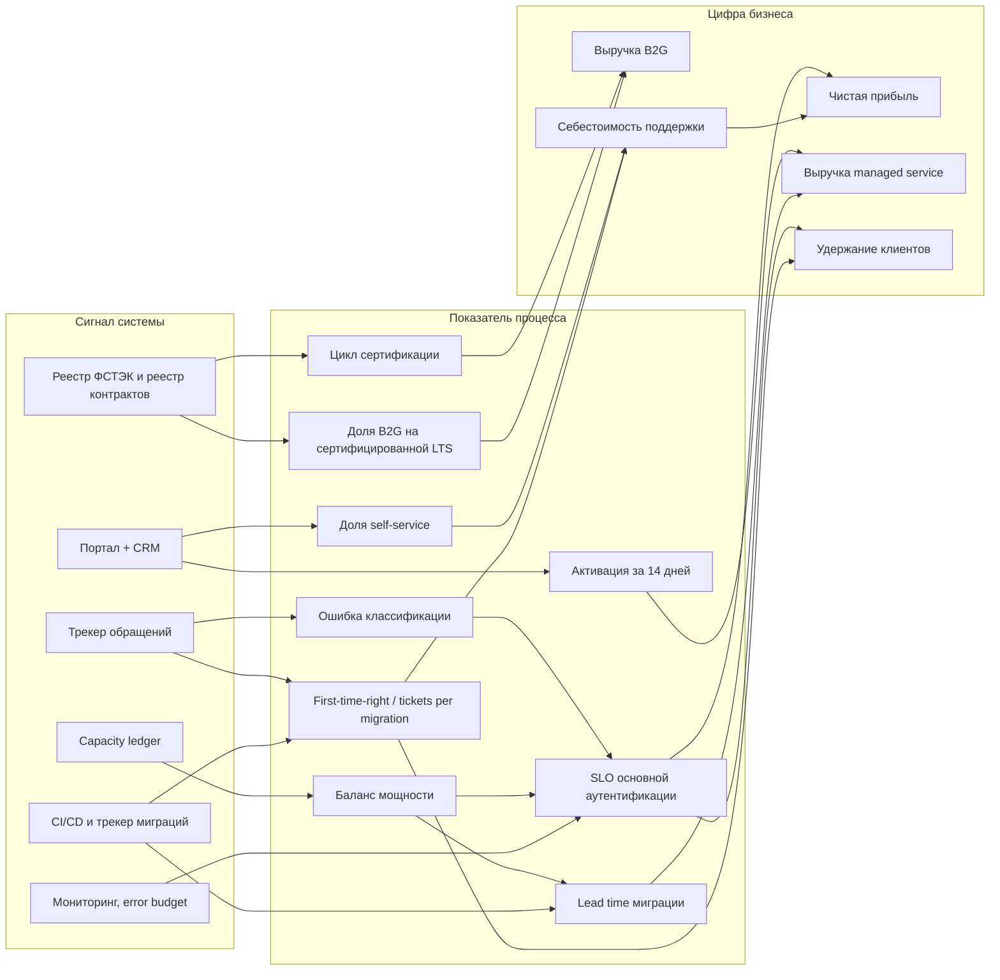

# Санкт-Петербургский Национальный Исследовательский Университет Информационных технологий, механики и оптики

## Практическая работа №4 — Показатели, модель и бюджет

**Выполнил:** Наумов Михаил Андреевич  
**Группа:** М4200с  
**Санкт-Петербург, 2026**

### Краткая версия паспорта проекта

| № | Поле | Описание |
|---|---|---|
| 1 | Бизнес | ООО «МУЛЬТИФАКТОР», российский разработчик ПО для информационной безопасности и IT-инфраструктуры, SaaS/On-Premise |
| 2 | Масштаб | 1,18 млрд ₽ за 2025 год, публичные данные (Rusprofile и Cnews) |
| 3 | Направления | Продажа ПО и сервисов: флагманы Multifactor и Multidirectory, точное распределение не раскрывается |
| 4 | ИТ-функция | Собственная разработка, современный стек, 2FA; по ПР3 процессы 1–3, зоны гипотез H1 — 🟡, H3 — 🟡, H5 — 🔴, зелёной нет |
| 5 | Ограничения | Точное распределение выручки по продуктам не раскрывается, нормировка не требуется (открытая отчётность) |

---

## 1. Цель, база и границы

ПР4 отвечает на три вопроса руководства:

1. **Что идёт по плану** — какие обязательства уже выполняются и какой показатель это подтверждает.
2. **Что требует решения** — где показатель не достигнут или упирается в мощность, деньги или поставщика.
3. **Что ухудшается** — где тренд идёт вниз, даже если средняя цифра выглядит приемлемо.

Работа опирается на процессы и замеры ПР3:

| Источник | Что берётся |
|---|---|
| ПР3, процессы 1–3 | шаги, потери, изменения, эффекты, точки замера |
| ПР3, раздел 12 | лебеди, capacity ledger, сертификация, долги |
| ПР2 | гипотезы 1, 3, 5, эффекты 24–47 и 12–30 млн ₽, D1–D33 |
| ПР1 | ИТ-бюджет 421 млн ₽, остаточный дефицит 87–188 млн ₽, сценарии §13–16 |
| ПР3, D34–D49 | допущения по времени, проверке, миграциям, сертификации |
| Публичная отчётность 2024–2025 | P&L для сверки модели с историей |

**База сценариев — D25 (реестр ПР2), значение из ПР1 §14.2:** выручка 1 310 млн ₽, чистая маржа 0,155, чистая прибыль 203 млн ₽. Это сценарий после шести месяцев, а не аудит 2025 года: факт 2025 — 1 181 млн ₽ и 250 млн ₽ чистой прибыли. Проценты и сопоставление с коридором считаются от базы 2025 года 1 181 млн ₽, как в ПР2. Базовый сценарий без изменений включает потерю H5 12–30 млн ₽: без сертифицированной LTS и решения по подрядчику эта выручка не защищена. Поэтому прибыль базового сценария — 198,4–201,1 млн ₽, а D25 203 млн ₽ — точка отсчёта до потери.

**Что не входит:** гипотезы 2 и 4 из резерва, новые продукты, внешнее финансирование. Новые деньги — только перераспределение внутри 421 млн ₽.

**Ограничения работы:**

- пилота ещё нет, поэтому процессные эффекты — прогноз, а не факт;
- история 2024–2025 содержит структурный сдвиг, который ограничивает перенос модели;
- часть точек замера нужно создать с нуля: активация за 14 дней, lead time миграции, цикл сертификации;
- целевые значения без частоты и точки съёма обязательством не являются и в бюджет не попадают.

---

## 2. Дерево показателей



**Подписанные связи**

| Нижний показатель | Верхний показатель | Почему считается, что нижний двигает верхний | Источник |
|---|---|---|---|
| SLO основной аутентификации | Чистая прибыль, удержание | Сбой аутентификации — клиенто-заметный инцидент; в ИБ-сегменте он бьёт по удержанию и штрафам | ПР1 §14, ПР3 §2, 12.7 |
| Активация за 14 дней | Выручка managed service | Быстрая активация сокращает time-to-value и повышает вероятность продления | ПР2, гипотеза 1 |
| Доля self-service | Себестоимость поддержки | Типовые обращения уходят из очереди, ФОТ не растёт вместе с объёмом | ПР2 D26, ПР3 §3 |
| Ошибка классификации | SLO, себестоимость поддержки | Ошибка «типовая вместо инцидента» задерживает реакцию и расходует error budget | ПР3 §2, 12.1 |
| Lead time миграции | Выручка managed service | Долгая миграция откладывает выручку и съедает мощность | ПР2, гипотеза 3; ПР3 §6–7 |
| First-time-right и tickets per migration | Себестоимость поддержки, удержание | Переделки и обращения после cutover стоят денег и снижают доверие | ПР3 §7, D48 |
| Цикл сертификации | Выручка B2G | Без сертификата заказчик не может обновиться и продлить контракт | ПР2, гипотеза 5; приказ ФСТЭК № 55 |
| Доля B2G на сертифицированной LTS | Выручка B2G | Контракт с фиксированной датой не продлевается на несертифицированной версии | ПР2 D24, D32 |
| Баланс мощности | Lead time миграции, SLO | Проверка, миграции, SLO и Build делят одну полосу; дефицит вытесняет слабейшую работу | ПР3 §3, 12.1 |
| Себестоимость поддержки | Чистая прибыль | Это прямая статья затрат; рост объёма без роста ФОТ улучшает маржу | ПР1 §13.5, ПР2 D26 |

**Правило отбора:** метрика, которая не связана ни с одной цифрой бизнеса или не имеет точки съёма, в отчёт не включается. Поэтому в дереве нет «числа закрытых тикетов» как самостоятельной цели: оно нужно только как знаменатель стоимости и качества.

---

## 3. KPI и OKR

KPI удерживают то, что нельзя уронить. OKR сдвигают то, что должно измениться за цикл. Провал OKR — нормальный исход амбициозной цели; провал KPI — сигнал остановки.

| Тип | Показатель | Горизонт | Цель или порог | Как можно натянуть | Чем компенсируется |
|---|---|---|---|---|---|
| KPI | SLO основной аутентификации | Постоянно | ≥ 99,95% в месяц; ниже 99,90% — немедленная остановка роста; ниже 99,95% два месяца — остановка | Исключить инциденты из знаменателя, сузить сценарий | Фиксированное правило отбора, аудит error budget, публичный SLO-отчёт |
| KPI | SLA реакции поддержки | Постоянно | ≥ 95% обращений с первым ответом в срок тарифа 60–120 минут (D62) | Закрывать тикет до фактического ответа, дробить обращения | Метка первого ответа, выборочный аудит, жалобы клиентов |
| KPI | First-time-right миграции | Постоянно | ≥ 80% — порог D48; цель уточняется после первых двух миграций | Переклассифицировать переделку в «изменение» | Чеклист приёмки, tickets per migration, аудит cutover |
| KPI | Tickets per migration | Постоянно | ≤ 3 за 30 дней после cutover — порог D48 | Закрывать обращения раньше, не считать повторные | Окно 30 дней, дедупликация по клиенту, выгрузка трекера |
| KPI | Цикл сертификации LTS | Постоянно | 3–6 месяцев | Назвать дату позже, исключить очередь лаборатории | Реестр ФСТЭК, SLA подрядчика, независимый владелец |
| KPI | Доля B2G на сертифицированной LTS | Постоянно | 100%, любая несертифицированная версия — красная зона | Считать только прямые контракты, не считать канал | Реестр контрактов + реестр ФСТЭК, включая интеграторов |
| KPI | Баланс мощности | Постоянно | ≥ 0 часов в месяц | Показывать только освобождённую полосу, не вычитать резерв | Capacity ledger, запрет неподтверждённой полосы |
| OKR | Активация за 14 дней | 2 месяца | +15 п.п. к базовой линии | Считать незавершённую регистрацию активацией | Проверка первого успешного фактора, контрольная группа |
| OKR | Доля self-service | 3 месяца | 40–60% типовых операций | Считать повторные попытки и ошибочные входы | Дедупликация операций, контрольный сегмент |
| OKR | Lead time миграции | 6 месяцев | −20% к базовой линии; p50 ≤ 60 дней, p90 ≤ 90 для нестандарта | Начать отсчёт позже, исключить ожидание клиента | End-to-end метка от подписания до cutover, отдельный учёт ожидания клиента |
| OKR | Дата B2G и уведомление | 60 дней | Дата, владелец и следующее обновление отправлены двум заказчикам | Объявить дату без SLA и буфера | Проверка SLA, письма заказчиков, реестр сертификатов |

**Главная ошибка KPI:** превратить его в цель и натягивать. Поэтому у каждого KPI есть парная метрика качества или аудит. **Главная ошибка OKR:** превратить его в список задач. Поэтому у каждого OKR есть порог и опровергающее наблюдение, а не чеклист внедрения.

---

## 4. Паспорта метрик

| № | Метрика и единица | Формула и правило отбора | Точка съёма и владелец | Частота и задержка | Целевое значение и обоснование | Что искажает |
|---|---|---|---|---|---|---|
| 1 | Активация за 14 дней, % | Числитель: лицензии с первым успешным фактором за 14 дней. Знаменатель: выданные лицензии когорты, кроме тестовых, отменённых и дублей. Отбор — по дате выдачи лицензии, одна лицензия на рабочее место | Портал + CRM + система лицензий; владелец — продуктовый владелец портала | Месячная когорта, задержка 7 дней | Базовая линия + 15 п.п. за 2 месяца; порог OKR. База не измерена, поэтому первая цель — измерить её за 2 недели | Тестовые лицензии, незавершённая регистрация как активация, сезонность, ручная активация поддержкой |
| 2 | Доля self-service, % | Числитель: завершённые типовые операции в портале. Знаменатель: self-service + типовые обращения в поддержку. Инциденты и нетиповые запросы исключены | Портал + трекер; владелец — руководитель поддержки и продукт | Неделя, задержка 3 дня | 40–60% типовых операций (D20); порог 20% — иначе гипотеза не сработала (D60) | Повторные попытки, ошибочные входы, переклассификация обращений |
| 3 | Ошибка классификации, % | Числитель: подтверждённые ошибки в проверенной выборке. Знаменатель: проверенные классификации. High-risk — 100%, остальные — 10% | Трекер + QA-выборка; владелец — руководитель поддержки | Неделя, задержка 7 дней | ≤ 5% после двух недель 100% проверки (D58); до этого — базовая линия | Смещение выборки, субъективность проверяющего, переклассификация |
| 4 | SLO основной аутентификации, % | Числитель: успешные подтверждения за нормативное время. Знаменатель: все попытки за месяц, кроме плановых работ по контракту. Правило исключений фиксируется до месяца | Мониторинг и error budget; владелец — SRE/CTO | Месяц, задержка 1 день | ≥ 99,95% (ПР1/ПР3); ниже 99,90% — немедленная остановка роста; ниже 99,95% два месяца — остановка | Исключение инцидентов, узкий знаменатель, сдвиг часов, синтетические пробы |
| 5 | Lead time миграции, дни | Числитель: календарные дни от подписания договора до принятого cutover. Знаменатель: число миграций. Считаются p50 и p90 отдельно для стандарта и нестандарта; ожидание клиента показывается отдельно | CRM + трекер миграций; владелец — руководитель миграций | Месяц, задержка 5 дней | p50 ≤ 60 дней, p90 ≤ 90 для нестандарта (D61); −20% к базовой линии | Поздний старт отсчёта, исключение переделок, ожидание клиента |
| 6 | Качество миграции | First-time-right: принятые без переделки / все миграции. Tickets per migration: обращения за 30 дней после cutover / миграции | Чеклист приёмки + трекер; владелец — руководитель миграций и поддержки | Месяц, задержка 5 дней | First-time-right ≥ 80%, tickets per migration ≤ 3 (D48); цель уточняется после первых двух миграций | Переделка как «изменение», раннее закрытие тикетов, дубли |
| 7 | Цикл сертификации LTS, дни | Числитель: дни от плановой даты релиза до выдачи сертификата. Знаменатель: число релизов. Разбивка: сборка, очередь лаборатории, выдача | Реестр ФСТЭК + SLA подрядчика + план релизов; владелец — владелец сертификации | По релизу, месячный обзор | 3–6 месяцев (D41); больше 6 — остановка | Сдвиг даты, очередь, неполная заявка, объём версии |
| 8 | Доля B2G на сертифицированной LTS, % | Числитель: B2G-выручка на актуальной сертифицированной версии. Знаменатель: вся B2G-выручка, включая канал интеграторов. Версия — по контракту | Реестр контрактов + реестр ФСТЭК + CRM; владелец — владелец сертификации и CFO | Квартал, задержка 10 дней | 100%; любая несертифицированная версия — красная зона | Канал не в реестре, версия по дате, неучтённые продления |
| 9 | Баланс мощности, часы/месяц | Освобождено порталом − проверка − SLO-резерв − часы двух клиентов − часы миграций. Резерв 20%, неподтверждённая полоса не входит | Capacity ledger + портал + трекер; владелец — CTO | Месяц, задержка 5 дней | ≥ 0; отрицательный баланс — стоп | Двойной счёт, gross вместо net, неподтверждённая полоса |
| 10 | Себестоимость поддержки, ₽/обращение | Числитель: ФОТ поддержки + инструменты. Знаменатель: закрытые обращения за месяц. Инциденты и типовые запросы считаются отдельно | HR/финансы + трекер; владелец — руководитель поддержки и CFO | Месяц, задержка 10 дней | Не растёт быстрее объёма; база 72,8 млн ₽ / 44–125 тыс. = 582–1 655 ₽ | Аллокация ФОТ, дробление тикетов, автоматизация, сезонность |
| 11 | SLA реакции поддержки, % | Числитель: обращения с первым ответом в срок тарифа. Знаменатель: все обращения за месяц, кроме спама и тестовых. Тариф и канал фиксируются | Трекер поддержки; владелец — руководитель поддержки | Месяц, задержка 3 дня | ≥ 95% в срок (D62); ниже — разбор по каналам | Дробление обращений, закрытие до ответа, часовой пояс |
| 12 | Дата B2G, соблюдение | Бинарно: дата объявлена за 60 дней. Числом: дни опоздания фактического сертификата против обещанной даты | Реестр контрактов + письма + реестр ФСТЭК; владелец — владелец сертификации | По релизу, квартальный обзор | Дата объявлена ≤ 60 дней; факт ≤ обещанной даты (D63) | Позднее объявление, сдвиг очереди, неполная заявка |

---

## 5. Экран руководства

Экран читается за минуту и отвечает на три вопроса. Это не дашборд из десятков графиков, а список решений.

| Зона | Метрика | Сейчас | Цель | Тренд | Решение | Владелец | Следующая сверка |
|---|---|---|---:|---|---|---|---|
| 🟡 | SLA реакции поддержки | 60–120 минут по тарифу; доля соблюдения не измеряется | ≥ 95% в срок (D62) | Нет данных | Запустить замер соблюдения SLA | Руководитель поддержки | Ежемесячно |
| 🟢 | Валовая маржа | 79,9% (2025) | ≥ 79% | Стабильно | Держать; проверить после миграций | CFO | Квартал |
| 🟡 | Активация за 14 дней | Не измеряется | База +15 п.п. за 2 месяца | Нет данных | Запустить замер и пилот H1 | Продуктовый владелец портала | Через 2 недели |
| 🟡 | Доля self-service | Не измеряется | 40–60% типовых операций | Нет данных | Пилот H1; порог 20% | Руководитель поддержки | Через месяц |
| 🟡 | Lead time миграции | Не измеряется | −20%; p50 ≤ 60 дней | Нет данных | Пилот H3 на двух клиентах | Руководитель миграций | Через месяц |
| 🟡 | Баланс мощности | Нижний сценарий −1,44 тыс. ч | ≥ 0 | Ухудшается при 100% проверке | Ввести capacity ledger; решить по двум клиентам | CTO | Ежемесячно |
| 🔴 | SLO основной аутентификации | 99,85% | ≥ 99,95% | Ухудшается | Остановить миграции роста до восстановления; SLO-резерв | CTO/SRE | Ежемесячно |
| 🔴 | Дата B2G | Не названа | Дата, владелец, уведомление | Не определено | Назначить независимого владельца; SLA; письмо заказчикам | Владелец сертификации | Через 30 дней |
| 🔴 | Чистая маржа | 15,5% (D25) | 20,0% (D6) | Ниже базы | Решение собственников: бюджет, цель или риск качества | CEO/CFO | Квартал |

Валовая маржа 79,9% — факт 2025 года; чистая маржа 15,5% — D25/прогноз. Это разные периоды, их нельзя сравнивать напрямую; на экране они подписаны.

**Что теряется при свёртке**

- **Среднее прячет хвост.** Средняя активация 60% может означать 90% у крупных клиентов и 20% у части enterprise-клиентов. Для активации нужны p50/p90 и разрез по размеру клиента.
- **Зелёная сумма прячет красный сегмент.** Общая доля B2G на сертифицированной версии 95% может скрывать одного крупного заказчика на несертифицированной версии. Для B2G нужен разрез по контрактам, а не сумма.
- **Средний lead time прячет нестандарт.** Средние 60 дней могут означать 40 дней для стандарта и 120 для нестандарта. Для миграций нужны p50/p90 и отдельный разрез «стандарт/нестандарт».
- **Месячный баланс мощности прячет один отрицательный месяц.** Годовой средний баланс может быть положительным при провале в квартал внедрений. Нужен месячный минимум, а не среднее.

**Две ключевые метрики — распределение, а не только среднее**

| Метрика | p50 сейчас | p90 сейчас | p50 цель | p90 цель | Разрез |
|---|---:|---:|---:|---:|---|
| Время активации, дни | Не измеряется | Не измеряется | ≤ 7 | ≤ 14 | Размер клиента, канал |
| Lead time миграции, дни | Не измеряется | Не измеряется | ≤ 60 | ≤ 90 | Стандарт / нестандарт |

Пока p50/p90 не измерены, экран показывает «нет данных», а не ноль. Ноль был бы ложной зелёной зоной.

---

## 6. Модель

### 6.1 Что моделируется

Модель табличная. Она отвечает не на вопрос «какой будет выручка», а на вопрос: **сходятся ли эффекты ПР3 в P&L и в мощности одновременно**. Два слоя:

1. **P&L:** выручка, маржа, чистая прибыль; прибыль от продаж — контрольная строка.
2. **Мощность:** освобождённые часы, проверка, SLO-резерв, два клиента, миграции.

База — D25: `R0 = 1 310 млн ₽`, `M0 = 0,155`, `P0 = 203 млн ₽`. Проценты и коридор — от 1 181 млн ₽.

### 6.2 Формулы

```
P0 = R0 × M0 = 1 310 × 0,155 = 203,1 млн ₽
PS0 = R0 × (0,799 − 0,414 − 0,162) = 292,1 млн ₽   (контроль по структуре 2025)

H_freed = F × s × t / 60
H_check_100 = F × (1 − s) × 3 / 60
H_check_risk = H_check_100 × (0,1 + 0,9 × 2 / 52)
H_reserve = 0,2 × H_freed
H_balance = H_freed − H_check − H_reserve − H_clients

ΔP_H3 = ΔR_H3 × M
ΔP_H5 = −Cost_H5
ΔP_H1 = −H_check × 1 000 / 1 000 000

P_expected = P0 + ΔP_H3 + ΔP_H5 + ΔP_H1
```

H5 в ожидаемом сценарии не добавляет выручку: она уже входит в D25. Защита H5 означает, что база без изменений теряет 12–30 млн ₽, а ожидаемый сценарий эту потерю не получает. Партнёрская экономия 0,03–0,36 млн ₽ — разовая и учитывается в бюджете, а не в годовой прибыли.

`PS0` — не фактическая прибыль D25, а контрольная линия по структуре затрат 2025 года. Она нужна, чтобы отделить операционный эффект от прочих доходов и налогов.

### 6.3 Входы модели

| Вход | База D25 | Ожидаемый | Пессимистичный | Источник |
|---|---:|---:|---:|---|
| Выручка `R` | 1 310 | 1 310 + 24…47 | 1 310 + 24 | ПР1 §14.2; ПР2 H3 |
| Чистая маржа `M` | 0,155 | 0,155 | 0,140 | D25; пессимистичный — D59 |
| H3-выручка | 0 | 24–47 | 24 | ПР2, гипотеза 3 |
| H5: потеря выручки | 12–30 | 0 (защита) | 30 | ПР2, гипотеза 5 |
| H1-проверка | 0 | 0,18–0,34 | 2,50 | ПР3, раздел 3; D37 |
| H5-стоимость | 0 | 2,5–6,0 | 2,5–6,0 | D42–D43 |
| Два клиента, тыс. ч | 0 | 3,60 | 3,60 | D22, D40 |
| SLO-резерв | 0 | 20% | 20% | D39 |

Входы привязаны к паспортам: поток, доля self-service и время операции — паспорта 2 и 9; H3 — паспорт 5; H5 — паспорта 7–8; H1 — паспорта 3 и 9. Партнёрская экономия 0,03–0,36 млн ₽ — разовая, в бюджете; в годовую прибыль она не входит. SLO-резерв взят 20% — верхняя граница D39; при 15% баланс улучшается на 0,15–0,94 тыс. ч, но консервативная оценка оставлена 20%.

### 6.4 Сверка с историей

Модель настраивается на 2024 году и проверяется на 2025-м. Периоды разные, поэтому это не подгонка под тот же год.

| Показатель, млн ₽ | 2024 факт | 2025 факт | 2025 модель по 2024 | Факт − модель | Комментарий |
|---|---:|---:|---:|---:|---|
| Выручка | 1 008,0 | 1 181,3 | 1 181,3 | 0 | Выручка задана как вход |
| Валовая прибыль | 590,7 | 943,7 | 692,2 | +251,5 | Валовая маржа выросла 58,6% → 79,9% |
| Коммерческие расходы | 0 | 489,3 | 0 | +489,3 | В 2025 появился канал и его расходы |
| Управленческие расходы | 72,0 | 191,9 | 84,4 | +107,5 | Рост управленческих расходов |
| Прибыль от продаж | 518,6 | 262,5 | 607,8 | −345,3 | Ошибка модели −56,8% к модели |
| Чистая прибыль | 597,4 | 250,0 | 700,1 | −450,1 | Ошибка −64,3% к модели |

**Что это значит.** 2024 и 2025 — разные режимы. В 2025 году появились коммерческие расходы 489,3 млн ₽ (41,4% выручки), валовая маржа выросла на 21,3 п.п., управленческие расходы — на 9,1 п.п. выручки. Модель 2024 года не переносится на 2025-й: она ошибается на 345,3 млн ₽ по прибыли от продаж. Поскольку выручка задана как вход, это проверка структуры затрат и маржи, а не прогноз выручки. Это не повод подогнать коэффициент; это граница применимости.

**Вывод для ПР4:** сценарии строятся в режиме 2025/D25, а не по тренду 2024. Процессный слой (активация, миграции, сертификация) на 2024 году проверить нельзя: в открытых данных нет тикетов и часов. Он проверяется пилотом на реальных пользователях с контрольной группой, как требует научная рамка курса. Чистая прибыль 2024 (597,4) выше валовой (590,7) из-за прочих доходов, поэтому операционный контроль ведётся по PS, а чистая прибыль используется как контекст.

**Мост 2025 → база ПР2 → D25**

| Показатель | 2025 факт | База ПР2 | D25 |
|---|---:|---:|---:|
| Выручка, млн ₽ | 1 181,3 | 1 181,3 | 1 310,0 |
| Чистая маржа | 0,212 | 0,200 | 0,155 |
| Чистая прибыль, млн ₽ | 250,0 | 236,0 | 203,0 |
| Что это | Аудит 2025 | Консервативная база ПР2 | Сценарий после 6 месяцев |

Разница 250 → 236 — нормировка к марже 20%, а не факт. Разница 236 → 203 — стресс D25: маржа 15,5% вместо 20,0%. Это не ошибка, а разные конструкции; на экране периоды подписаны.

**Мост PS → чистая прибыль**

| Показатель, млн ₽ | 2025 факт | D25 | База с потерей H5 |
|---|---:|---:|---:|
| Прибыль от продаж | 262,5 | 292,1 | 285,4–289,4 |
| Чистая прибыль | 250,0 | 203,0 | 198,4–201,1 |
| Прочие расходы, налоги и стресс маржи | 12,5 | 89,1 | 86,9–88,3 |

PS-контроль — не второй прогноз чистой прибыли, а проверка операционной структуры. В D25 разрыв 89,1 млн ₽ больше фактических 12,5 млн ₽ потому, что D25 уже содержит стресс маржи 15,5%; это не скрытая статья, а цена сценария.

### 6.5 Прогноз до наблюдения

**Дата фиксации прогноза: 2026-10-31. Горизонт: 2026-11-30.** Прогноз записан до появления данных; после факта он не переписывается.

| Что наблюдаем | Прогноз на 2026-11-30 | Порог остановки | Точка съёма |
|---|---|---|---|
| Активация за 14 дней | +5 п.п. к базовой линии за первый месяц; +15 п.п. за два месяца | Меньше +5 п.п. через месяц | Портал + CRM |
| Self-service | 20–25% типовых операций за первый месяц; 40–60% за три месяца | Меньше 20% через три месяца | Портал + трекер |
| Ошибка классификации | ≤ 5% после двух недель 100% проверки | Больше 10% | QA-выборка |
| SLO | ≥ 99,90% в первый месяц; ≥ 99,95% ко второму | Ниже 99,90% в любом месяце или ниже 99,95% два месяца | Мониторинг |
| Первые две миграции | Lead time 2–4 месяца; вендорские часы −30…−50%; first-time-right ≥ 80%; tickets ≤ 3 | First-time-right < 80% или tickets > 3 | Трекер миграций |
| B2G | Вне месячного горизонта: независимый владелец к 2026-11-30; SLA и дата заказчикам — 60-дневный milestone до 2026-12-30 | Нет владельца за 30 дней; нет SLA за 60 | Реестр ролей, SLA, письма |

### 6.6 Три сценария

| Сценарий | Триггер | R, млн ₽ | M | H3, млн ₽ | H5, млн ₽ | H1, млн ₽ | H5-стоимость, млн ₽ | Чистая прибыль, млн ₽ | PS контроль, млн ₽ | Баланс мощности, тыс. ч |
|---|---|---:|---:|---:|---:|---:|---:|---:|---:|---:|
| Базовый без изменений | Ничего не делаем; H5 теряется | 1 310 | 0,155 | 0 | потеря 12–30 | 0 | 0 | 198,4–201,1 | 285,4–289,4 | 0 |
| Ожидаемый | H1, H3 и H5 работают | 1 334–1 357 | 0,155 | 24–47 | 0 (защита) | 0,18–0,34 | 2,5–6,0 | 200,5–207,7 | 291,1–299,9 | −1,44…+11,06 |
| Пессимистичный | Повторный push-инцидент и постоянные 100% проверки | 1 304 | 0,140 | 24 | потеря 30 | 2,50 | 2,5–6,0 | 174,1–177,6 | — | отрицательный |

PS-контроль показан для базового и ожидаемого сценариев. В пессимистичном он не используется как обязательство, потому что маржа 0,14 ломает структуру затрат 2025 года; справочно PS по структуре 2025 был бы около 282–286 млн ₽, а разрыв с чистой прибылью 174–178 млн ₽ — это и есть стресс маржи и прочие расходы. В базовом PS-контроль учитывает потерю H5, в ожидаемом — защиту H5. `PS0 = 292,1` в формуле — до потери H5; поэтому базовая PS-контроль ниже на 2,7–6,7 млн ₽.

**Пессимистичный сценарий.** Основной триггер — повторный push-инцидент, который переводит проверку в постоянные 100%. В этом сценарии маржа падает до 0,14, H5 теряет 30 млн ₽ выручки, H1 забирает 2,50 млн ₽, а H5-стоимость остаётся 2,5–6,0 млн ₽. Прибыль — 174,1–177,6 млн ₽: ниже D25 на 25,5–29,0 млн ₽ и ниже базы без изменений на 20,8–27,0 млн ₽.

**Ожидаемый сценарий.** H3 даёт 24–47 млн ₽ выручки, H5 защищает 12–30 млн ₽, H1 стоит 0,18–0,34 млн ₽, H5 стоит 2,5–6,0 млн ₽. H5 не добавляется к выручке: она уже в D25, защита означает, что база без изменений теряет 12–30 млн ₽, а ожидаемый сценарий — нет. Чистая прибыль — 200,5–207,7 млн ₽: против базы без изменений 198,4–201,1 это −0,6…+9,3 млн ₽, против D25 203 — −2,6…+4,6 млн ₽. Это не ошибка модели, а главный вывод: **изменения ПР3 защищают мощность и удержание, но не закрывают разрыв до цели 349 млн ₽**. Прибыль от продаж как контрольная строка растёт сильнее — 291,1–299,9 млн ₽, потому что операционная маржа 22,2% выше чистой 15,5% даже после вычета H5-стоимости.

**Гейт мощности.** H3 начисляется только при балансе ≥ 0. В нижней точке ожидаемого сценария баланс −1,44 тыс. ч, поэтому один клиент задерживается, а H3 берётся по нижней границе 24 млн ₽. Если задержать нельзя, H3 не начисляется и сценарий переходит в пессимистичный.

### 6.7 Что модель не доказывает

- Она не доказывает, что пилот сработает: это расчёт, а не наблюдение.
- Она не переносит 2024 год на 2025-й: структурный сдвиг больше любой калибровки.
- Она не заменяет контрольную группу: активация и lead time подтверждаются только пилотом.
- Она не складывает эффекты гипотез: мощность — общее ограничение, а H5 — защита выручки, а не новая выручка.
- Она не предполагает восстановление маржи до 0,20: если оно произойдёт, это upside, а не план.

---

## 7. Бюджет

### 7.1 Разовые и постоянные затраты

Бюджет не увеличивает 421 млн ₽. D15 (интеграционная фабрика) уже внутри этого бюджета; новые деньги — перераспределение внутри него. Экономия консолидации 13–16 млн ₽ заранее не закладывается.

| Блок | Статья | Разово, млн ₽ | Постоянно, млн ₽/год | Источник | Внутри 421 млн ₽ |
|---|---|---:|---:|---|---|
| Разовые | Портал самообслуживания | 0,5–1,5 | — | D33 | Перераспределение |
| Разовые | Обучение и сертификация партнёров | 1,0–3,0 | — | D51 | Перераспределение |
| Разовые | Юридическое сопровождение, предоплата подрядчику | 0,4–1,5 | — | D43 | Перераспределение |
| Разовые (экономия) | Партнёрская схема | −0,03…−0,36 | — | D44, D49 | Перераспределение |
| Постоянные | Интеграционная фабрика D15, включая сборку стандартного пакета и sandbox | 8,0–12,0 (первый год, внутри D15) | 23,0–26,0 | D15 | Внутри D15 |
| Постоянные | Независимый владелец сертификации | — | 0,5–1,0 | D42 | Перераспределение |
| Постоянные | Резервный подрядчик | — | 2,0–5,0 | D43 | Перераспределение |
| Постоянные | Проверка классификаций | — | 0,18–0,34 | D37 | Перераспределение |
| Не деньги | Располагаемая мощность после SLO-резерва | — | 2,16–14,66 (упущенная мощность) | D39 | Не cash, opportunity cost |

Строка D15 включает 8–12 млн ₽ первого года; она не добавляется к 23–26 млн ₽. Предоплата 0,4–1,5 млн ₽ — кассовый график внутри 2–5 млн ₽ подрядчика, не дополнительная стоимость P&L. Партнёрская экономия 0,03–0,36 млн ₽ — разовая. **Новые деньги вне D15:** 4,6–12,0 млн ₽ в первый год. Это верхняя граница того, что нужно перераспределить внутри 421 млн ₽. Если перераспределение не подтверждено, сокращаются Build и необязательные Grow, а не качество. Сам SLO-резерв — 0,59–3,75 тыс. ч; 2,16–14,66 млн ₽ — это остаток после него, а не резерв.

### 7.2 Эффект и окупаемость

| Сценарий | ΔP к базе без изменений, млн ₽ | Окупаемость разовых затрат 1,9–5,6 млн ₽ |
|---|---:|---|
| Ожидаемый, низ | −0,6 | Не окупается |
| Ожидаемый, центр | +4,4 | 0,4–1,3 года |
| Ожидаемый, верх | +9,3 | 0,2–0,6 года |
| Пессимистичный | −20,8…−27,0 | Не окупается |

**Что это значит.** Постоянные затраты уже вычтены в ΔP, поэтому окупаемость считается по разовым 1,9–5,6 млн ₽, а не по всем 4,6–12,0 млн ₽ — иначе постоянные посчитались бы дважды. Ожидаемый центр окупается за 0,4–1,3 года, верх — за 0,2–0,6; нижняя граница не окупается. Пессимистичный сценарий не окупается. Компоненты H3, H5 и H1 — в таблице 6.6; партнёрская экономия 0,03–0,36 — разовая, в бюджете, не в ΔP.

**В процентах от базы 1 181 млн ₽:** H3 — 2,0–4,0%, H5-защита — 1,0–2,5%, H1+H5-стоимость — −0,23…−0,54%, чистая прибыль — −0,05…+0,79%. H1-мощность 2,16–14,66 млн ₽ — это 0,18–1,24% базы, но не выручка; в проценты она попала только для сопоставимости.

**H1-мощность — не деньги.** 2,16–14,66 млн ₽ после SLO-резерва — это часы, а не прибыль. Если они не конвертированы в H3, они не попадают в P&L. Если конвертированы, эффект уже учтён в H3. Складывать H1 и H3 нельзя.

**H5 — не источник прибыли.** H5 защищает 12–30 млн ₽ выручки, но стоимость владельца и подрядчика 2,5–6,0 млн ₽ может съесть всю маржу. В нижней точке H5 даёт −4,14 млн ₽ относительно D25. Это страховка B2G-выручки и сертификатов, а не инвестиция с гарантированной доходностью.

### 7.3 Критерии остановки

| Инициатива | Наблюдение | Порог остановки | Действие |
|---|---|---|---|
| H1 | Активация за 14 дней | Меньше +5 п.п. через месяц | Остановить пилот, вернуть ручную верификацию |
| H1 | Self-service | Меньше 20% через три месяца | Пересмотреть портал, не масштабировать |
| H1 | Ошибка классификации | Больше 10% | Вернуть 100% проверку, пересмотреть агента |
| H1 | SLO | Ниже 99,90% в любом месяце или ниже 99,95% два месяца | Остановить миграции роста, восстановить SLO |
| H1 | Баланс мощности | Меньше 0 | Задержать одного клиента или заморозить Build/Debt |
| H3 | Lead time | Не снизился на 20% за 6 месяцев | Остановить партнёрскую схему, вернуть вендора |
| H3 | First-time-right / tickets | < 80% или > 3 | Вернуть миграцию в вендорский поток |
| H3 | Качество партнёра | Ниже D48 | Расторгнуть пилот, пересмотреть D44 |
| H5 | Независимый владелец | Не назначен за 30 дней | Остановить сертификационный релиз |
| H5 | SLA и дата | Нет SLA за 60 дней; дата не названа за 60 | Эскалация CTO и собственникам |
| H5 | Цикл сертификации | Больше 6 месяцев | Пересмотреть подрядчика и график |
| Общий | Новые затраты | Больше 12,0 млн ₽ | Остановить необязательные работы |
| Общий | Маржа | Ниже 0,155 | Вернуться к собственникам с ценой решения |
| Общий | Данные | Нет точки съёма или владельца | Остановить инициативу до замера |

### 7.4 Честный trade-off

- **Ожидаемый сценарий почти не двигает чистую прибыль относительно D25:** 200,5–207,7 против 203,1 млн ₽, то есть −2,6…+4,6. Но против базы без изменений 198,4–201,1 он даёт −0,6…+9,3 млн ₽. Основная ценность — сохранённая мощность, SLO и удержание, а не немедленная прибыль.
- **H3 — единственный источник роста выручки в модели.** H5 защищает, H1 освобождает. Если H3 не сработает, бюджет не окупается.
- **H5 может быть убыточной.** В нижней точке −4,14 млн ₽ относительно D25; относительно базы с потерей H5 эффект иной. Решение о H5 — это решение о допустимом риске B2G, а не о ROI.
- **H1 может ухудшить мощность.** Постоянные 100% проверки забирают 1,32–2,50 млн ₽ и 1,32–2,50 тыс. часов; в низком сценарии итоговый дефицит баланса до 2,58 тыс. часов.
- **Бюджет внутри 421 млн ₽, но не бесплатный.** Новые 4,6–12,0 млн ₽ — это перераспределение, а не дополнительный бюджет. Если его нет, сокращаются Build/Debt или задерживаются клиенты.

---

## 8. Выводы для руководства

1. **PR4 подтверждает разрыв ПР2.** Изменения ПР3 не приводят к 349 млн ₽ прибыли первого года и тем более к 766 млн ₽. Они защищают мощность, SLO и B2G-удержание, но не закрывают разрыв.
2. **Главный положительный эффект — H3.** 24–47 млн ₽ выручки дают 3,72–7,29 млн ₽ чистой прибыли при марже 0,155. Без H3 остальные изменения не окупаются.
3. **H5 — страховка, а не доход.** 12–30 млн ₽ защищённой выручки могут стоить 2,5–6,0 млн ₽, а в нижней точке дать −4,14 млн ₽. Решение о H5 принимается по риску B2G и сертификатов.
4. **H1 — условие мощности, а не прибыль.** 2,16–14,66 млн ₽ после SLO-резерва — это часы. Их нельзя записывать в прибыль и нельзя обещать дважды: H1 и H3 делят одну полосу.
5. **Диапазон важнее средней.** Ожидаемый центр окупает разовые затраты за 0,4–1,3 года, верх — за 0,2–0,6; нижняя граница не окупается. Пессимистичный не окупается. Бюджет защищается по нижней границе и критериям остановки.
6. **Нужны решения собственников:** перераспределение 4,6–12,0 млн ₽ внутри 421 млн, KPI закупок (долг №8 ПР1), дата B2G (долг №7 ПР1) и допустимый риск H5. Без этих решений модель остаётся расчётом, а не планом.

**Что изменит вывод:** измеренная базовая линия активации, фактические часы первых двух миграций, цикл сертификации и фактическая маржа. До этих замеров ПР4 — это дисциплинированная оценка, а не обещание результата.

---

## 9. Реестр допущений

Допущения D1–D49 наследуются из ПР1–ПР3 без изменений. Новые допущения ПР4:

| ID | Допущение | Значение | Источник и обоснование | Уверенность | Кто или что проверит |
|---|---|---|---|---|---|
| D50 | Доля D15 первого года на сборку стандартного пакета и sandbox | 8–12 млн ₽ внутри D15 23–26 млн ₽/год | D15 — 23–26 млн ₽/год (ПР1, §4.1). 8–12 — доля первого года внутри этой суммы, а не дополнительная статья; steady-state D15 остаётся 23–26 | низкая | Фактическая смета D15 и учёт рабочего времени команды |
| D51 | Обучение и сертификация партнёров | 1–3 млн ₽ разово | Оценка по числу партнёров (Merlion, Softline, Инфарс) и стоимости обучения; в открытых данных нет | низкая | Договоры с партнёрами и смета обучения |
| D52 | Структурный сдвиг 2025 года | 2024 и 2025 — разные режимы; модель 2024 не переносится на 2025 | TAdviser: коммерческие расходы 0 → 489,3 млн ₽, валовая маржа 58,6% → 79,9%, управленческие 72 → 191,9 млн ₽ | высокая по данным, низкая по переносу | Повторная сверка по отчётности 2026 года |
| D53 | Дата и значения прогноза | Дата фиксации 2026-10-31, горизонт 2026-11-30; значения в таблице 6.5 | Правило курса: прогноз записывается до наблюдения. Дата ставится до старта пилота | сценарий | Сравнение с фактом 2026-11-30 |
| D54 | Триггер пессимистичного сценария | Повторный push-инцидент и постоянные 100% проверки; либо два клиента не влезают в мощность; либо подрядчик не согласован и дата B2G не названа | Лебеди 1 и 2 ПР3; события уже описаны | сценарий | Первый месяц пилота и решение по подрядчику |
| D55 | База сценариев | D25: 1 310 млн ₽, маржа 0,155, чистая прибыль 203 млн ₽ | ПР1 §14.2; ПР2 использует D25 как точку отсчёта | средняя | Фактическая отчётность месяца 12–18 |
| D56 | Контрольная строка «прибыль от продаж» | 292,1 млн ₽ при R = 1 310 млн ₽ по структуре 2025 года | 2025: валовая маржа 79,9%, коммерческие 41,4%, управленческие 16,2% выручки. Это не фактическая PS D25, а контроль | средняя | Отчёт о финансовых результатах 2026 года |
| D57 | Восстановление маржи в ожидаемом сценарии | Не предполагается; маржа 0,155 | D25 — фактическая точка; рост маржи до 0,20 — upside, а не план | высокая | Фактическая маржа месяца 12 |
| D58 | Порог ошибки классификации | ≤ 5% | Управленческий порог для пилота H1; до двух недель 100% проверки базовая линия не известна | низкая | QA-выборка и трекер поддержки |
| D59 | Маржа пессимистичного сценария | 0,140 | D25 0,155 минус 1,5 п.п. на цены, микс и прочие потери; это стресс-маржа **до** вычета H5-стоимости и H1. H5 и H1 вычитаются отдельно, поэтому двойного счёта нет | низкая | Фактическая маржа месяца 12 |
| D60 | Порог self-service | 20% типовых операций | Управленческий порог остановки H1; цель 40–60% остаётся из D20. Порог нужен, чтобы отличить пилот от провала | низкая | Портал и трекер после трёх месяцев |
| D61 | Целевые p50/p90 | Активация 7/14 дней; lead time миграции 60/90 дней для нестандарта | Управленческие цели для экрана и OKR; до первого замера это ориентир, а не факт | низкая | Первый месяц пилота и первые две миграции |
| D62 | Целевое соблюдение SLA поддержки | ≥ 95% обращений с первым ответом в срок | Управленческий порог для KPI SLA; тариф 60–120 минут уже есть, доля соблюдения не измеряется | низкая | Трекер поддержки за месяц |
| D63 | Целевое соблюдение даты B2G | Дата объявлена ≤ 60 дней; факт ≤ обещанной даты | Управленческий порог для OKR даты B2G; до SLA и первого цикла это ориентир | низкая | Письма заказчикам и реестр ФСТЭК |

---

## 10. Источники

Источники №1–25 наследуются из ПР3 (раздел 14). Новые источники ПР4:

26. ООО «МУЛЬТИФАКТОР»: выручка 1 008 млн ₽ в 2024 году (+91,6% к 2023), 1 181,3 млн ₽ в 2025 году (+17%); валовая прибыль 590,7 → 943,7 млн ₽; коммерческие расходы 0 → 489,3 млн ₽; управленческие 72 → 191,9 млн ₽; прибыль от продаж 518,6 → 262,5 млн ₽; чистая прибыль 597,4 → 250 млн ₽ // TAdviser URL: https://www.tadviser.ru/index.php/Компания:Мультифактор_(Multifactor) (дата обращения: 20.10.2026)
27. Бухгалтерская отчётность ООО «МУЛЬТИФАКТОР» за 2025 год (РСБУ): выручка 1 181 274 000 ₽ (+17% к 2024), ИНН 9725026066, ОГРН 1197746716310 // Rusprofile URL: https://www.rusprofile.ru/id/11954232 (дата обращения: 20.10.2026)

Ссылки на ПР1–ПР3 в тексте даны по разделам и карточкам гипотез. Ветка `pw_4` не наследует файлы ПР1–ПР3 по требованию к структуре работы: отсылки вида «ПР1, сценарии §…», «ПР2, раздел…» и «ПР3, раздел…» читаются в ветках `pw_1`, `pw_2` и `pw_3`.
